# Design Document

## Overview

The Food Delivery Platform is delivered as two deployable artifacts plus three supporting processes:

- **Delivery_API** — a Laravel modular monolith exposing a versioned REST contract at `/api/v1`, and the single write path for all Platform data (Requirements 20, 22).
- **Web_Client** — a React + TypeScript + Vite SPA that holds no authoritative domain state (Requirements 29, 41).
- **Queue_Worker**, **Realtime_Gateway** (Laravel Reverb), and **scheduler** — separate processes sharing the Delivery_API codebase (Requirements 21, 42.5, 45.1).

The design is driven by four structural commitments that every later section obeys:

1. **Module ownership.** Domain code lives in exactly 14 modules. A module owns its tables and is reachable only through a `Module_Boundary` interface or a published domain event (Requirement 22). Cross-module SQL is forbidden and statically enforced.
2. **One call path.** Every write travels the `Backend_Layer_Chain`: Controller → Form_Request → Service_Interface → Service_Implementation → Repository (concrete class) → Eloquent_Model → PostgreSQL (Requirement 38). Controllers hold no rules; services hold all rules; repositories hold all queries. Repositories are concrete classes rather than interface/implementation pairs — a deliberate deviation from the requirements glossary, recorded under [Deviations from the requirements document](#deviations-from-the-requirements-document).
3. **Determinism at the core.** Money is integer minor units with explicit half-up rounding; geometry round-trips exactly; Order_State changes only through one state machine. These three areas carry the property-based test suite (Requirements 7.4, 5.4, 5.5, 10.1, 23.4).
4. **Explainability as a deliverable.** Every decision recorded as an ADR, every diagram as Mermaid text, every module documented in the same change set as its code (Requirements 30, 54, 55).

### Technology bindings

| Concern | Binding | Rationale (recorded as ADR per Requirement 54.6) |
| --- | --- | --- |
| API framework | Laravel 12 (PHP 8.4) | Mandated. Provides container, queues, broadcasting, validation, migrations in one runtime, which keeps the layer chain of Requirement 38 expressible without extra glue. |
| Database | PostgreSQL 16 + PostGIS | Mandated. PostGIS supplies indexed, boundary-inclusive polygon containment for Requirement 5.8 without a paid geospatial service (Requirement 43.7/43.8). |
| Cache, queue, Cart | Redis 7 | Mandated. One engine covers cached read models, rate-limit counters, Cart state, and the queue backend (Requirements 21.1, 6.6). |
| Realtime | Laravel Reverb | Mandated and sole implementation in the initial phase (Requirement 42.1). |
| Payments | `Payment_Gateway` interface + `Simulated_Payment_Gateway` | Requirement 36. No live provider is bound in the initial phase. |
| Local environment | Docker Compose, six services | Requirement 24.1. |
| CI/CD | GitHub Actions, OIDC to AWS | Requirements 25, 47. |
| Production | CloudFront → ALB → ECS Fargate, RDS, ElastiCache, S3 | Requirement 45.1–45.2, provisioned manually and documented (Requirement 45.5–45.7). |
| Backend PBT | `giorgiosironi/eris` driven from Pest | Requirement 23.4 needs ≥100 generated inputs, seed and shrink reporting (Requirement 23.12). |
| Frontend PBT | `fast-check` with Vitest | Same, for Web_Client pure logic. |
| Boundary enforcement | Deptrac + custom PHPStan rules + ESLint import rules | Requirements 22.4, 36.7, 38.8, 41.8. |

### Explicit non-goals for the initial implementation phase

No live Payment_Provider, no declarative infrastructure-as-code, no AWS-native or paid location service, no hosted WebSocket service, no notification channel other than `email` and `in_app` (Requirements 36.3, 45.5, 43.7, 43.8, 42.1, 16.6).

---

## Architecture

### System context

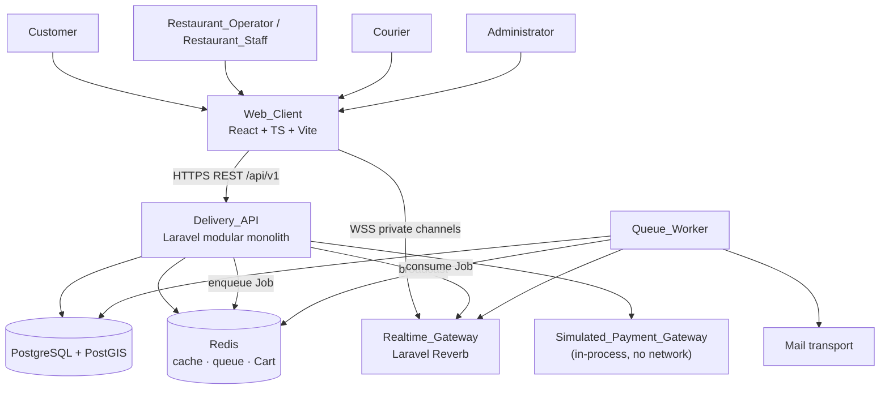

### Container architecture and process split

The Realtime_Gateway and the Queue_Worker run as processes separate from the Delivery_API, locally and in production (Requirements 42.5, 45.1). They share the application image so that domain code, events, and configuration are identical across processes.

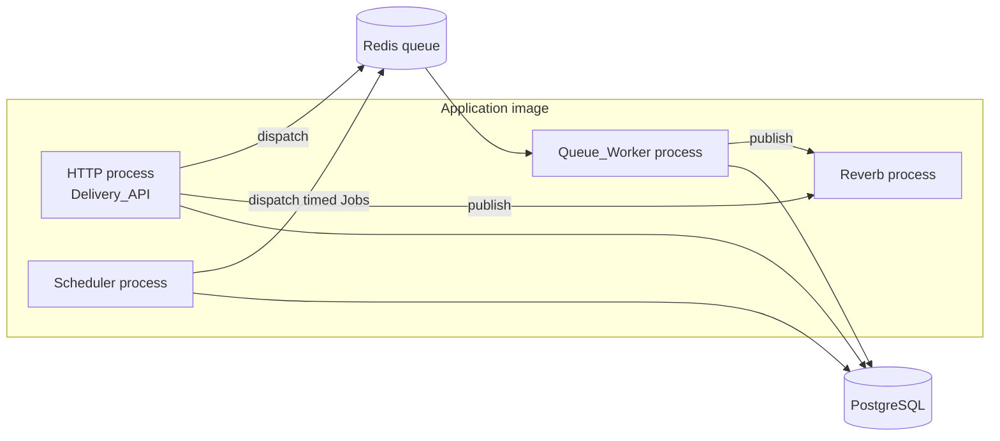

The scheduler exists because three behaviours are time-driven rather than request-driven: Dispatch offer cycles and escalation (Requirement 13.5, 13.6, 13.10), the un-accepted-Order reminder series (Requirement 12.6), and Courier_Location retention pruning (Requirement 14.7).

### Module map

Exactly 14 domain modules, no domain code outside them (Requirement 22.1). Arrows are permitted dependencies, and every arrow is an interface call or an event subscription, never a cross-module query (Requirement 22.2, 22.8).

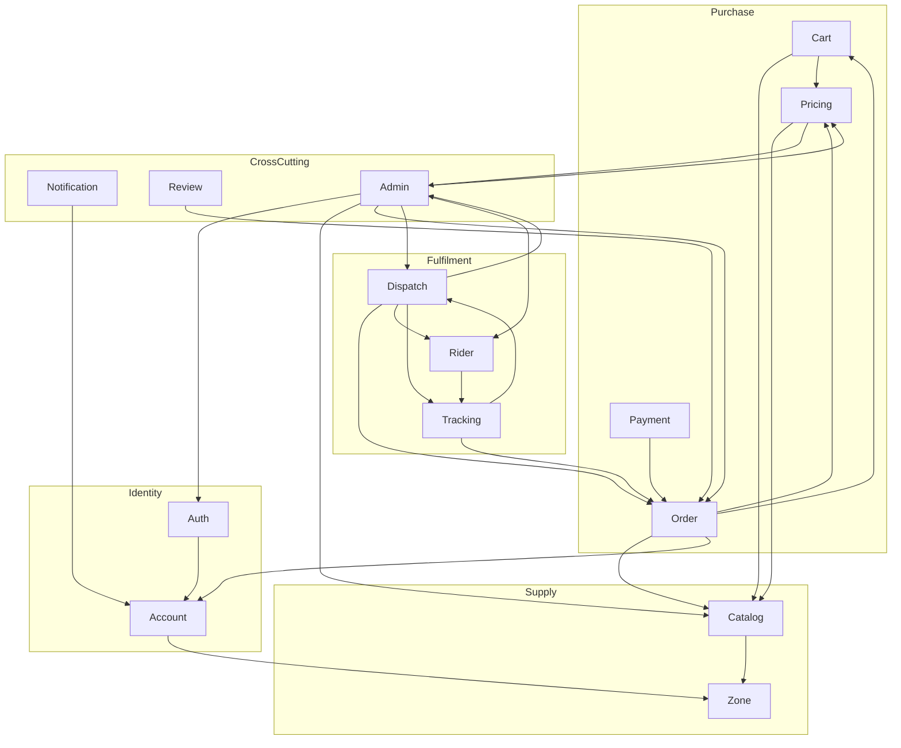

Two dependency rules resolve the cycles that a naive reading would produce:

- **Pricing and Dispatch read Platform_Configuration** through `PlatformConfigurationReader`, a read-only boundary interface owned by Admin. Admin owns the table because Requirement 37.9 makes Administrators the only writers.
- **Downstream modules never call upstream modules.** Order does not call Payment, Dispatch, Notification, or Review; those modules subscribe to the `order.state_changed` domain event (Requirements 10.15, 39.4). This keeps the Order module free of fulfilment knowledge and makes the Observer pattern the single integration mechanism for reactions.

### Backend layer chain

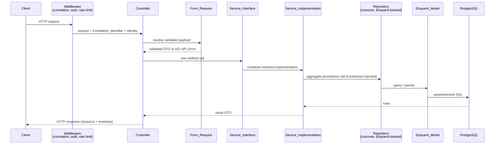

Repositories are concrete classes, not interface/implementation pairs — see [Deviations from the requirements document](#deviations-from-the-requirements-document). A Service_Implementation depends on the repository class through constructor injection and the container resolves it, so the injection rule of Requirement 38.4 still holds; only the extra interface is dropped.

Constraints enforced statically (Requirement 38.8): a Controller may not reference an Eloquent_Model or a Repository; a Service_Implementation may not reference a Controller; an Eloquent_Model may not reference a Service_Interface. Additional custom rules cover Requirement 36.6 (no Payment_Provider symbol outside the Payment module) and Requirement 22.8 (no model of another module referenced from a repository).

### Deviations from the requirements document

One deliberate deviation from the requirements text, recorded here and to be carried into an ADR (Requirement 54.1) because it alters a cross-cutting convention:

| Requirement text affected | Design decision | Rationale |
| --- | --- | --- |
| Glossary entry `Backend_Layer_Chain`, and Requirement 38.1, 38.4, 38.6, which name `Repository_Interface → Repository_Implementation` | Each module declares **concrete, Eloquent-backed repository classes** with no per-repository interface. The effective chain is Controller → Form_Request → Service_Interface → Service_Implementation → **Repository (concrete class)** → Eloquent_Model → PostgreSQL. | Two reasons. (1) **Reduced indirection for a single persistence technology.** PostgreSQL through Eloquent is the only persistence target in every environment, so a second repository implementation is never bound; a per-repository interface would add a file and an indirection with no second implementor, which Requirement 38.7 explicitly forbids ("introduce an interface … only where a second implementation, a test double requirement, or a Module_Boundary requirement applies"). (2) **Testing runs against a real database rather than repository doubles.** Requirement 23.3 already mandates feature tests through the HTTP layer against a PostgreSQL database reset to a fixture state, and Requirement 47.9 runs those suites against the production major versions, so no test needs to substitute a repository double. |

What does **not** change: `Service_Interface` abstractions remain, exactly as Requirement 38 states; `Module_Boundary` interfaces remain (they satisfy Requirement 38.7's Module_Boundary reason); the `Payment_Gateway`, `AddressResolver`, `Clock`, `IdGenerator`, `GeoJsonParser`, and `GeoJsonPrinter` abstractions remain, because each has either a second implementation or a test-double requirement. Repositories stay a distinct layer — all SQL and all Eloquent use still live behind them (Requirement 38.6's placement rule), and the Repository pattern is still recorded as a Design_Pattern_Record (Requirement 39.3) with this deviation as its "alternative considered".

### Directory layout

```
app/
  Modules/
    Order/
      Http/{Controllers,Requests,Resources}
      Contracts/Services/                     # Service_Interface only (no repository interfaces)
      Services/                               # Service_Implementation
      Repositories/                           # concrete Eloquent-backed repository classes
      Models/                                 # Eloquent_Model
      Domain/                                 # framework-free: OrderStateMachine, value objects
      Events/ Listeners/ Jobs/
      Boundary/                               # public Module_Boundary interfaces + DTOs
      Providers/OrderServiceProvider.php      # container bindings
  Shared/
    Domain/{Money,Coordinate,TimeRange,Page}  # framework-free value objects
    Http/{ApiError,Envelope,Middleware}
    Support/{Clock,IdGenerator,Correlation}
```

`Domain/` holds framework-free classes only, satisfying Requirement 22.5. Every external dependency (mail, gateway, geocoder, clock, id generator) sits behind an interface owned by the consuming module and is bound in that module's service provider (Requirement 22.6, 38.4).

### Cross-cutting request pipeline

| Order | Middleware | Behaviour | Requirements |
| --- | --- | --- | --- |
| 1 | `AssignCorrelationIdentifier` | Accepts `X-Correlation-Id`, otherwise generates a ULID; binds it into the log context, the queue job payload, and the broadcast payload; returns it in response headers. | 27.3–27.5 |
| 2 | `SecurityHeaders` | Sets HSTS, `X-Content-Type-Options`, `X-Frame-Options`, CSP. | 28.9 |
| 3 | `Cors` | Restricts origins to the configured Web_Client list. | 28.4 |
| 4 | `AuthenticateBearer` | Resolves the opaque Access_Token; `401 unauthenticated` when absent/malformed, `401 invalid_token` when revoked or expired. | 1.11, 2.2 |
| 5 | `AuthorizeRole` | Evaluates the Role recorded in the database on every request, never a Role claim carried in the token. | 2.3, 2.10 |
| 6 | `ThrottleRequests` | 60 requests/minute per authenticated user per endpoint group; 20/minute per unauthenticated client on auth endpoints; `Retry-After` on 429. Counters live in Redis. | 28.3 |
| 7 | `JsonApiResponse` | Wraps resources in the standard envelope, renders API_Error, converts unhandled exceptions to `internal_error`. | 20.2–20.4, 27.9 |

### Authentication design

Requirements 1.5–1.11, 18.3, and 33.6 require short-lived Access_Tokens, rotating Refresh_Tokens, and revocation that takes effect within 5 seconds — including for tokens already issued. A stateless JWT cannot satisfy revocation without a denylist, so the design uses **opaque database-backed tokens**: a 256-bit random secret returned to the client, stored only as a SHA-256 hash, with `expires_at` and `revoked_at` columns. Revocation is a single `UPDATE` and is visible to the next request, which satisfies the 5-second bound by construction. The Role is read from `users` on every request, satisfying Requirement 2.10.

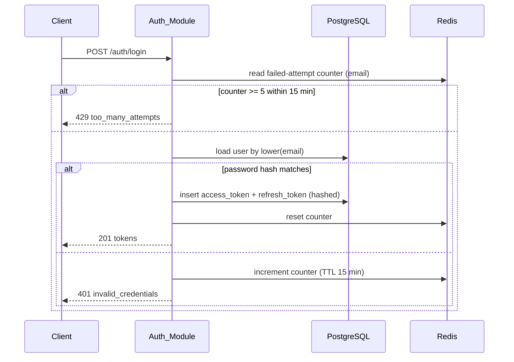

The failed-attempt counter lives in Redis with a 15-minute TTL, which gives the "reset to 0 when the rejection period ends" behaviour of Requirement 1.7 without a scheduled cleanup, and is independent of the per-minute limiter of Requirement 28.3.

### Order lifecycle orchestration

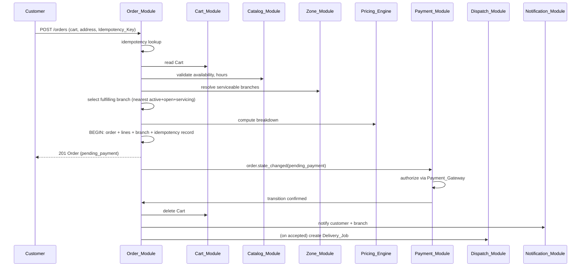

Order creation and payment are deliberately decoupled: the checkout transaction commits the Order in `pending_payment` and returns, then the Payment_Module reacts to the state event. This keeps the Requirement 40.10 transaction narrow (no gateway call inside a transaction) and makes Requirement 8.8 satisfiable — a post-commit failure can only leave `pending_payment` or a state-machine transition to `cancelled`.

### Dispatch offer cycle

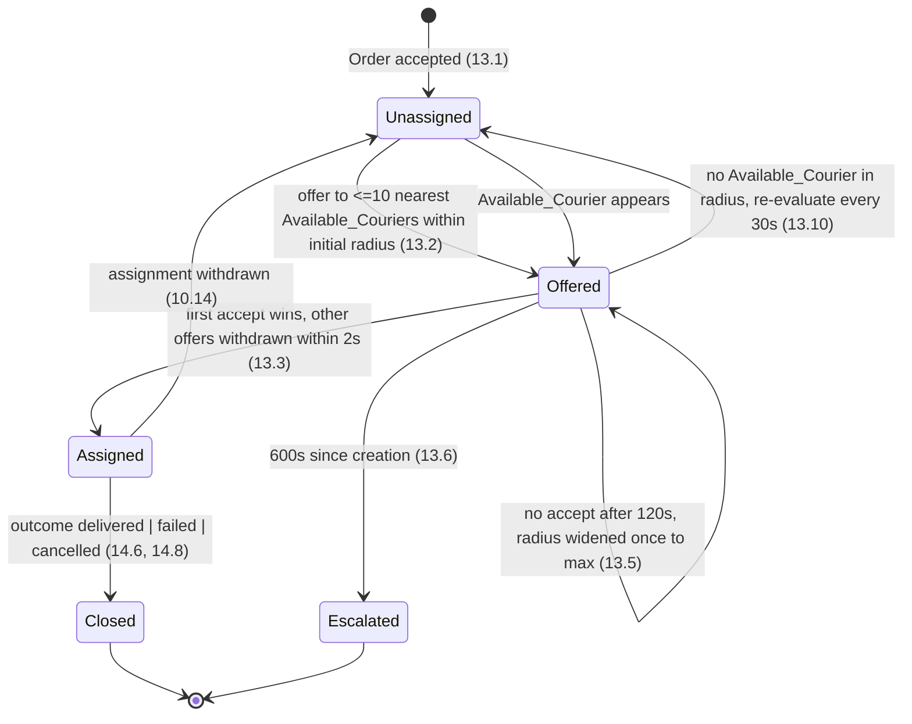

The cycle is implemented as a self-rescheduling queued Job keyed by `delivery_job_id`. Each execution reads the current job row, computes the action, and writes at most one state change, which makes repeated execution of the same Job harmless (Requirement 21.7).

### Realtime design

Exactly five Realtime_Events and four private channel families (Requirements 42.2, 15.1):

| Channel | Authorized subscribers | Events |
| --- | --- | --- |
| `private-order.{orderId}` | the placing Customer, the fulfilling Restaurant's Operator, the fulfilling Branch's Staff, the assigned Courier, an Administrator | `order.created`, `order.state_changed`, `courier.location_updated` |
| `private-restaurant.{restaurantId}` | that Restaurant's Operator, an Administrator | `order.state_changed` |
| `private-branch.{branchId}` | that Branch's Staff, the Restaurant's Operator, an Administrator | `order.created`, `order.state_changed` |
| `private-courier.{courierId}` | that Courier, an Administrator | `delivery.state_changed`, `notification.created` |

Channel authorization reuses the same policy objects that guard the corresponding REST resource, so a subscription cannot see more than a GET would (Requirement 15.2, 15.3, 33.7). Broadcast failures are caught, logged, and never fail the originating request (Requirement 42.6); the Web_Client therefore treats events as advisory and re-reads state through the Query_Client before gating an action (Requirements 15.6, 15.7, 42.7).

### Caching design

| Key | Contents | TTL | Invalidated by |
| --- | --- | --- | --- |
| `menu:v1:{restaurantId}` | Menu read model | 300 s | Catalog write, availability change, Restaurant_Status change (4.6, 34.7, 59.7) |
| `search:v1:{hash(query)}` | Restaurant search page | 300 s | Catalog write, Restaurant_Status change, rating projection update |
| `cart:v1:{customerId}` | Cart document | 72 h sliding | every Cart write (6.6) |
| `throttle:*`, `signin_fail:{email}` | counters | window length | TTL expiry |

Every cache read is wrapped by `CacheOrFallback`, which on a Redis error records the failure in the Observability_Stack and serves from PostgreSQL rather than failing the request (Requirement 21.4). Because the read model is derived from the same repository call that the fallback uses, cached and uncached responses are content-identical (Requirement 4.5).

### Local development topology

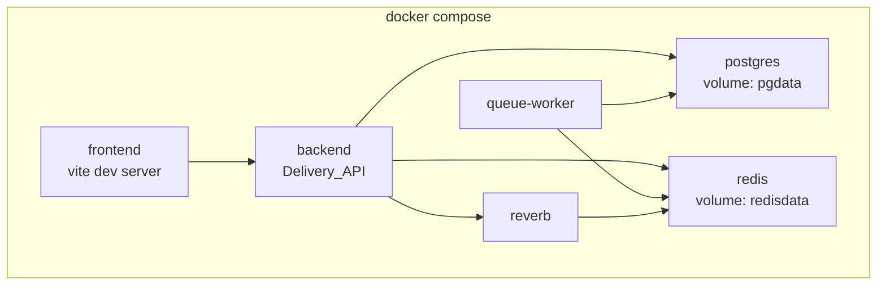

Exactly six services (Requirement 24.1). Source is bind-mounted; PostgreSQL and Redis data live in named volumes so a container rebuild preserves committed rows (Requirements 24.3–24.5). Documented commands cover start, migrate, seed, test, and the Courier movement simulator (Requirements 24.2, 24.7, 24.8, 24.10, 43.7).

### Production topology

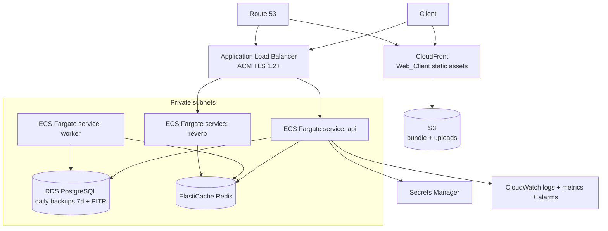

Three separately scalable ECS services (Requirement 26.1, 45.1); RDS and ElastiCache in private subnets (Requirements 26.9, 45.4); secrets injected at runtime (Requirements 26.6, 44.9); autoscaling on the CPU thresholds of Requirement 26.7. Every resource is created manually or by the Deploy_Pipeline and recorded in `docs/devops/aws.md` in the same change set, at a detail level sufficient to later reproduce it in code (Requirements 45.5–45.9), behind a Cost_Disclosure Approval_Gate (Requirement 46).

### CI/CD pipeline

```mermaid
graph LR
    PR["Pull request"] --> B1["static analysis<br/>PHPStan · Deptrac · ESLint · tsc"]
    B1 --> B2["backend suites<br/>unit · feature · property · integration"]
    B2 --> B3["frontend suites<br/>vitest + coverage"]
    B3 --> B4["contract & docs checks<br/>OpenAPI · docs tree · env vars · AC-to-test map"]
    B4 --> B5["Web_Client production build"]
    B5 --> B6["container image build"]
    B6 --> G{"all green?"}
    G -->|no| FAIL["fail status · block merge"]
    G -->|yes| MERGE["merge to main"]
    MERGE --> D1["build + push image to ECR (commit SHA)"]
    D1 --> D2["run migrations"]
    D2 --> D3["update ECS services"]
    D3 --> D4["await healthy steady state"]
    D4 --> D5["Smoke_Test_Suite"]
    D5 -->|fail| RB["restore previous image · report failure"]
    D5 -->|pass| DONE["deployment recorded"]
```

Gate checks beyond the test suites: dependency vulnerability scan failing on high/critical (Requirement 28.8), committed-secret scan (Requirement 44.6), environment-variable documentation parity (Requirement 44.7), Docs_Tree path existence (Requirement 55.3), OpenAPI-to-route equivalence (Requirement 20.6), Design_Pattern_Record freshness (Requirement 39.5), commit-message Task_ID prefix (Requirement 56.4), and acceptance-criterion-to-test mapping (Requirement 48.10). AWS credentials come from OIDC_Trust only (Requirements 25.9, 47.6).

---

## Components and Interfaces

Each module below states its responsibility, the tables it owns exclusively (Requirement 22.3), the `Module_Boundary` interfaces it publishes, its internal services, and the events it publishes or consumes. Boundary methods accept and return module-owned DTOs only — never Eloquent models — so that a module can later move behind a network call without a caller change.

### Shared kernel

Framework-free value objects used across modules. They are not a module and hold no rules of their own.

```php
final readonly class Money {           // Requirement 7.4, 20.9, 40.4
    public function __construct(public int $minorUnits, public string $currency) {}
    public function plus(Money $o): Money;                 // asserts currency equality
    public function minus(Money $o): Money;
    public function timesQuantity(int $q): Money;
    public function percentHalfUp(int $basisPoints): Money; // single rounding step
    public function clamp(Money $min, Money $max): Money;
}

final readonly class Coordinate {      // Requirement 40.7
    public function __construct(public string $latitude, public string $longitude); // decimal strings, 7 fd
    public function haversineKilometres(Coordinate $other): string; // half-up to 3 fd
}

final readonly class Page { public array $data; public int $total; public ?string $nextCursor; }
final readonly class ApiError { public string $code; public string $message; public array $fieldErrors; }
interface Clock { public function nowUtc(): DateTimeImmutable; }       // injected everywhere; never now()
interface IdGenerator { public function ulid(): string; }
```

`Clock` and `IdGenerator` are interfaces so that time-dependent rules (token expiry, offer windows, hours evaluation, timestamp windows) are deterministic under test — a precondition for the property suite.

### Auth_Module

**Responsibility:** credentials, tokens, Role assignment, authorization decisions, channel authorization.
**Owns:** `users`, `access_tokens`, `refresh_tokens`. Redis: `signin_fail:{email}`.

```php
interface AuthenticationService {                                  // Req 1
    public function register(RegisterCommand $c): CreatedUser;      // creates customer + profile in one tx
    public function login(LoginCommand $c): TokenPair;
    public function refresh(string $refreshToken): TokenPair;       // rotates, invalidates presented
    public function logout(string $accessToken): void;
    public function changePassword(ChangePasswordCommand $c): void;  // Req 31.5, 31.6
}

interface UserDirectory {                                          // Module_Boundary, Req 37.2, 33.1, 58.1
    public function createUser(CreateUserCommand $c): CreatedUser;  // role, optional restaurant/branch scope
    public function findById(string $userId): ?UserSummary;
    public function findByIds(array $userIds): array;
    public function setAccountStatus(string $userId, AccountStatus $s): void; // revokes tokens
    public function setRole(string $userId, Role $r): void;
    public function listUsers(UserFilter $f, PageRequest $p): Page;
}

interface AuthorizationService {
    public function can(ActorContext $actor, string $ability, ?ResourceRef $r): bool;
    public function authorizeChannel(ActorContext $actor, string $channel): bool; // Req 15.2
}
```

**Design notes.** `ActorContext` carries user id, Role, `restaurant_id`, and `branch_id`, and is built once per request from the database record so Requirement 2.10 holds. `setAccountStatus(suspended)` revokes all tokens of the user in the same transaction (Requirements 18.3, 33.6). Registration creates the `users` row and asks Account to create the profile and default Notification preferences inside one transaction (Requirements 1.1, 16.12).

### Account_Module

**Responsibility:** profiles, Delivery_Addresses, Notification preferences, email-change flow.
**Owns:** `user_profiles`, `delivery_addresses`, `notification_preferences`, `email_change_tokens`.

```php
interface ProfileService {                                         // Req 31.1–31.3
    public function getOwnProfile(string $userId): ProfileView;
    public function updateProfile(UpdateProfileCommand $c): ProfileView;
    public function requestEmailChange(RequestEmailChangeCommand $c): void;   // Req 31.4, 31.14
    public function confirmEmailChange(string $userId, string $token): void;  // Req 31.12, 31.13
}

interface AddressService {                                         // Req 31.7–31.11
    public function create(CreateAddressCommand $c): AddressView;   // resolves coordinates via Zone
    public function update(UpdateAddressCommand $c): AddressView;
    public function markDefault(string $userId, string $addressId): void;
    public function archive(string $userId, string $addressId): void;
    public function listOwn(string $userId): array;
}

interface AddressDirectory {                                       // Module_Boundary for Order/Pricing
    public function findOwnedAddress(string $userId, string $addressId): ?AddressSnapshot;
}

interface NotificationPreferenceReader {                           // Module_Boundary for Notification
    public function isEnabled(string $userId, NotificationCategory $c, Channel $ch): bool;
}
```

**Design notes.** Default-address uniqueness is enforced both in one transaction and by a partial unique index (Requirements 31.9, 40.3). Deletion archives rather than removes, so Order address snapshots stay intact (Requirement 31.10). Address lines and contact details are stored encrypted at rest through Laravel's encrypted casts, with a deterministic hash column where lookup is needed (Requirement 28.6).

### Catalog_Module

**Responsibility:** Restaurants, Restaurant_Branches, hours, Menus, Menu_Items, Product_Variants, Modifier_Groups/Options, search, Restaurant_Status lifecycle.
**Owns:** `restaurants`, `restaurant_cuisine_tags`, `restaurant_branches`, `opening_hours`, `branch_hours`, `menu_categories`, `menu_items`, `product_variants`, `modifier_groups`, `modifier_options`.

```php
interface RestaurantDiscoveryService {                             // Req 3
    public function search(RestaurantSearchQuery $q): Page;         // published + serviceable + filters
    public function view(string $restaurantId): RestaurantView;
}

interface MenuQueryService {                                       // Req 4
    public function menuFor(string $restaurantId): MenuReadModel;   // cache-through, 300 s
}

interface RestaurantAdminService {                                 // Req 32, 59; used by Admin boundary
    public function create(CreateRestaurantCommand $c): RestaurantView;     // status draft
    public function updateProfile(UpdateRestaurantCommand $c): RestaurantView;
    public function transitionStatus(RestaurantStatusTransition $t): RestaurantView;
    public function submitForReview(string $restaurantId, ActorContext $a): RestaurantView;
}

interface BranchService {                                          // Req 32.2–32.6, 32.11–32.14
    public function create(CreateBranchCommand $c): BranchView;
    public function setActive(string $branchId, bool $active): BranchView;
    public function replaceBranchHours(string $branchId, WeeklySchedule $s): void;
    public function assignZones(string $branchId, array $zoneIds): void;     // delegates to Zone
}

interface MenuManagementService { /* categories, items, variants, modifiers — Req 11, 34 */ }

interface CatalogBoundary {                                        // consumed by Cart, Order, Pricing
    public function findPublishedItem(string $itemId, ?string $variantId): ?PurchasableSnapshot;
    public function pricingProfile(string $restaurantId): RestaurantPricingProfile; // currency, tax, fees
    public function branchesServicing(string $restaurantId, Coordinate $at): array; // active+open+servicing
    public function isOpenNow(string $branchId): bool;
    public function assertAvailable(array $itemRefs): AvailabilityReport;
}
```

**Design notes.**

- `OpeningHoursEvaluator` is a framework-free component. It converts the current UTC instant into the branch's applicable IANA time zone, then tests membership in a half-open interval `[start, end)` measured in minutes from local midnight, falling back from Branch_Hours to Opening_Hours (Requirement 32.7).
- `BranchSelector` implements Requirement 32.9: filter to active ∧ open ∧ servicing, order by haversine distance ascending, break exact ties by ascending branch id.
- `RelevanceRanker` implements the four-tier deterministic ordering of Requirement 3.2 (exact name, name prefix, name substring, cuisine tag) with name then id as the tie-break.
- Search cursors are HMAC-signed payloads carrying the sort key and an issue timestamp, rejected after 15 minutes with `invalid_cursor` (Requirement 3.9).
- `aggregate_rating` is a Catalog-owned projection column updated by a listener on `review.aggregate_updated`, which lets the rating filter and sort run in SQL without Catalog querying Review's tables (Requirements 3.3, 17.4, 22.8).
- Deletion of a Menu_Item sets `archived_at` and never removes the row (Requirement 11.6).

### Zone_Module

**Responsibility:** Delivery_Zone geometry, GeoJSON parse/print, address resolution, serviceability.
**Owns:** `delivery_zones`, `delivery_zone_branch`, `geocode_cache`.

```php
interface ZoneService {                                            // Req 5.1–5.3
    public function create(string $restaurantId, string $geoJson): ZoneView;
    public function replaceGeometry(string $zoneId, string $geoJson): ZoneView;
    public function assignToBranch(string $branchId, array $zoneIds): void;  // Req 32.11
}

interface GeoJsonParser { public function parse(string $text): PolygonGeometry; } // throws GeoJsonViolation(offset)
interface GeoJsonPrinter { public function print(PolygonGeometry $g): string; }

interface ServiceabilityService {                                   // Module_Boundary
    public function isServiceable(string $restaurantId, Coordinate $at): bool;   // Req 5.8–5.10
    public function servicingBranchIds(string $restaurantId, Coordinate $at): array;
}

interface AddressResolver {                                         // Req 5.6, 5.7
    public function resolve(PostalAddress $a): Coordinate;           // throws AddressNotResolvable after 3000 ms
}
```

**Design notes.**

- `PolygonGeometry` is an immutable list of linear rings of `Coordinate` values, validated at construction against the limits of Requirement 5.1 (≥4 and ≤1,000 coordinate pairs per ring, ≤10 rings, closed rings, coordinate ranges).
- Coordinates are held and printed as decimal strings at 7 fractional digits, never as floats, which is what makes the round-trip properties of Requirements 5.4 and 5.5 exact rather than approximate.
- The canonical geometry is stored twice in one row: `geometry_geojson jsonb` (authoritative, printed by `GeoJSON_Printer`) and `geom geometry(Polygon, 4326)` (derived, indexed with GIST). Containment queries use `ST_Covers`, whose closed semantics give the boundary-inclusive behaviour of Requirement 5.8. A framework-free `RayCastContainment` evaluator provides the same decision in memory; a model-based property test asserts the two agree, which protects against silent divergence.
- `AddressResolver` is an interface with a local deterministic adapter in the initial phase — no paid geocoding service (Requirements 23.8, 43.7). A `geocode_cache` row keyed by normalized address avoids repeat work.

### Cart_Module

**Responsibility:** Cart state only. No pricing rules, no catalog rules.
**Owns:** Redis key `cart:v1:{customerId}`. No PostgreSQL table.

```php
interface CartService {                                            // Req 6, 34.3–34.5, 34.9
    public function view(string $customerId): CartView;             // includes Pricing breakdown
    public function addLine(AddCartLineCommand $c): CartView;
    public function changeQuantity(string $customerId, string $lineId, int $qty): CartView; // 0 removes
    public function removeLine(string $customerId, string $lineId): CartView;
    public function replaceFromOrder(string $customerId, string $orderId): ReorderResult;    // Req 19.3
    public function clear(string $customerId): void;
}

interface CartBoundary {                                           // consumed by Order
    public function snapshot(string $customerId, string $cartId): ?CartSnapshot;
    public function delete(string $customerId, string $cartId): void;
}
```

**Design notes.** The Cart document is a JSON structure `{cartId, restaurantId, currency, lines[], updatedAt}` written with a 72-hour expiry on every change (Requirement 6.6). `Cart_Line` identifiers are server-generated ULIDs. Validation order on add is: restaurant conflict (409) → item/variant existence (404) → availability (422) → variant selection rules (422) → modifier selection rules (422) → line limit (422) → quantity schema (422 in Form_Request, so it precedes all of these). Requirement 6.11 is satisfied by returning an empty document rather than 404 when no Cart exists.

### Pricing module (Pricing_Engine)

**Responsibility:** monetary computation and Promotions. No persistence of Orders.
**Owns:** `promotions`, `promotion_conditions`.

```php
interface PricingEngine {                                          // Req 7
    public function quote(PricingRequest $r): PriceBreakdown;       // provisional when no address (7.12)
}

final readonly class PriceBreakdown {
    public Money $lineSubtotal; public Money $deliveryFee; public Money $serviceFee;
    public Money $taxAmount;    public Money $discountAmount; public Money $orderTotal;
    public string $currency;    public bool $provisional;
}

interface PromotionService {                                       // Req 18.4
    public function create(CreatePromotionCommand $c): PromotionView;
    public function evaluate(string $code, CartSnapshot $cart): PromotionEvaluation;
}
```

**Computation order** — fixed, with one rounding step per produced value (Requirement 7.4):

1. `lineSubtotal` = Σ over available lines of `quantity × (basePrice + Σ modifier deltas)` (Requirements 7.1, 34.2, 34.9).
2. `deliveryFee` = `base + perKm × min(distanceKm, 20.000)` where `distanceKm` is half-up to 3 fractional digits, then clamped to `[minFee, maxFee]`. With no address selected, `deliveryFee = minFee` and the breakdown is marked provisional (Requirements 7.2, 7.12).
3. `serviceFee` = `percentHalfUp(lineSubtotal)` clamped to `[minServiceFee, maxServiceFee]` from Platform_Configuration (Requirement 7.9).
4. `taxAmount` = `taxRate` applied half-up to `lineSubtotal + deliveryFee + serviceFee` (Requirement 7.10).
5. `discountAmount` = promotion value clamped to `[0, lineSubtotal + deliveryFee]` (Requirements 7.5–7.7).
6. `orderTotal` = `lineSubtotal + deliveryFee + serviceFee + taxAmount − discountAmount`, asserted within `[0, 99,999,999]` (Requirement 7.3).

Percentages are carried as integer basis points and divided once, half-up, so identical inputs always give identical outputs — the invariant the pricing property tests exercise.

### Order_Module

**Responsibility:** Order records, Order_Lines, Order_State transitions, Order_Timeline, checkout idempotency, Order reads.
**Owns:** `orders`, `order_lines`, `order_line_modifiers`, `order_timeline_entries`, `idempotency_keys`.

```php
interface CheckoutService {                                        // Req 8, 40.10
    public function place(PlaceOrderCommand $c): PlacedOrder;       // idempotent per (customer, key)
}

interface OrderStateService {                                      // Req 10
    public function transition(OrderTransitionCommand $c): OrderView; // actor-checked, machine-checked
}

interface OrderQueryService {                                      // Req 2.4–2.9, 12.7, 12.8, 18.5, 19
    public function view(ActorContext $a, string $orderRef): OrderView;
    public function list(ActorContext $a, OrderFilter $f, PageRequest $p): Page;
    public function timeline(ActorContext $a, string $orderId): array;
}

interface OrderBoundary {                                          // consumed by Payment, Dispatch, Tracking, Review, Admin
    public function findSummary(string $orderId): ?OrderSummary;
    public function transitionAsModule(ModuleActor $m, string $orderId, OrderState $to, array $meta): OrderView;
    public function recordTimelineNote(string $orderId, TimelineNote $n): void;
}
```

**Order_State_Machine** — framework-free, the only code path that changes `orders.state` (Requirements 10.2, 39.4):

```php
final class OrderStateMachine {
    /** @return list<OrderState> */
    public function allowedFrom(OrderState $s): array;                       // 18 edges total
    public function permits(OrderState $from, OrderState $to): bool;
    public function actorsFor(OrderState $from, OrderState $to): ActorRuleSet;
    public function assertTransition(OrderState $from, OrderState $to, ActorContext|ModuleActor $by): void;
}
```

Evaluation order matters and is fixed: transition membership first (`409 invalid_state_transition`), then actor permission (`403 forbidden`), so a forbidden actor requesting an impossible transition still receives 409 (Requirements 10.4, 10.5). Terminal states `delivered` and `refunded` have an empty allowed set, and `cancelled`/`rejected` allow only `refunded`, which makes Requirements 10.7 and 10.8 fall out of the edge table rather than out of extra branching.

Every successful transition, inside the same transaction, appends one `order_timeline_entries` row and records one `order.state_changed` domain event for after-commit dispatch (Requirements 10.6, 10.15). Subscribers are Notification, Payment, Dispatch, and the broadcaster; Order knows none of them.

`Order_Number` is 10 characters from the uppercase alphanumeric alphabet, generated with a CSPRNG, retried at most 5 times on unique-violation, then `500 internal_error` (Requirements 8.2, 8.9).

### Payment_Module

**Responsibility:** Payment_Intent lifecycle, capture, refund, void, webhook ingestion. Sole owner of every Payment_Provider concept (Requirement 36.6).
**Owns:** `payment_intents`, `payment_events`, `refunds`.

```php
interface PaymentGateway {                                         // Req 36.1
    public function authorize(AuthorizeRequest $r): AuthorizationResult;
    public function capture(CaptureRequest $r): CaptureResult;
    public function refund(RefundRequest $r): RefundResult;
    public function verifyWebhookSignature(WebhookEnvelope $e): bool;
}

interface PaymentService {
    public function startForOrder(string $orderId): PaymentIntentView;   // Req 9.1
    public function handleWebhook(WebhookEnvelope $e): void;             // Req 9.5–9.7
    public function refundForOrder(string $orderId): RefundView;         // Req 9.8
    public function voidForOrder(string $orderId): void;                 // Req 9.14
}
```

**Design notes.**

- One adapter is bound at boot from a single environment variable; an unknown value terminates startup naming the variable (Requirement 36.2). The initial binding is `Simulated_Payment_Gateway` (Requirement 36.3).
- `Simulated_Payment_Gateway` derives every outcome from deterministic local rules keyed on the request amount and a documented test token, with no network call, and documents one input per outcome: success, decline, timeout, refund success, refund rejection (Requirements 36.4, 36.5).
- The Idempotency_Key sent to the gateway is derived from the Order identifier and is stable across retries (Requirement 9.4). Retries are 3 attempts with 1/2/4-second waits inside a queued Job, leaving the Order in `pending_payment` throughout (Requirement 9.9), then transitioning to `cancelled` with a payment-unreachable reason (Requirement 9.11).
- Webhook dedupe uses a unique constraint on `payment_events.provider_event_id` with a 7-day retention window; a duplicate is acknowledged with no state change, no capture, no refund, and no timeline entry (Requirement 9.7).
- Refund and void both end at `refunded`; a rejected refund leaves the Order in `cancelled`/`rejected`, records the reason on the timeline, and logs for Administrator follow-up (Requirements 9.12, 9.14).

### Dispatch_Module

**Responsibility:** Delivery_Job creation, offers, assignment, withdrawal, closure, escalation.
**Owns:** `delivery_jobs`, `delivery_job_offers`.

```php
interface DispatchService {                                        // Req 13, 14.6, 14.8
    public function createForAcceptedOrder(string $orderId): DeliveryJobView;
    public function acceptOffer(string $courierId, string $jobId): DeliveryJobView; // first accept wins
    public function markPickedUp(string $courierId, string $jobId): DeliveryJobView;
    public function markStarted(string $courierId, string $jobId): DeliveryJobView;
    public function markDelivered(string $courierId, string $jobId): DeliveryJobView;
    public function reportFailure(string $courierId, string $jobId, string $reason): DeliveryJobView;
    public function withdrawAssignment(string $jobId, string $reason): DeliveryJobView;
}

interface DeliveryJobBoundary {                                    // consumed by Rider, Tracking, Order, Admin
    public function activeJobForCourier(string $courierId): ?DeliveryJobSummary;
    public function findSummary(string $jobId): ?DeliveryJobSummary;
    public function jobForOrder(string $orderId): ?DeliveryJobSummary;
    public function listForAdmin(DeliveryJobFilter $f, PageRequest $p): Page;
}
```

**Design notes.** Assignment uses a conditional `UPDATE ... WHERE assigned_courier_id IS NULL` returning the affected row count, so concurrent accepts resolve to exactly one winner and the losers receive `409 job_already_assigned` (Requirement 13.3, 13.4). A partial unique index on `(assigned_courier_id)` restricted to active jobs enforces "at most one active Delivery_Job per Courier" at the database level (Requirements 13.7, 13.11). `Available_Courier` is a single predicate object evaluated identically in the SQL candidate query and in the in-memory classifier (Requirement 13.8). Escalation sets `escalated_at`, which is what the Administrator_Queue view selects on (Requirement 37.5).

### Rider_Module

**Responsibility:** Courier profile, Rider_Status, own job list, own history and summary.
**Owns:** `courier_profiles`.

```php
interface CourierProfileService {                                  // Req 58
    public function view(string $courierId): CourierProfileView;
    public function update(UpdateCourierProfileCommand $c): CourierProfileView;
}

interface RiderStatusService {                                     // Req 35.1–35.5, 58.4, 58.6
    public function goOnline(string $courierId): RiderStatus;        // requires vehicle type + phone
    public function goOffline(string $courierId): RiderStatus;       // 409 while active job
    public function setOnDelivery(string $courierId): void;          // called by Dispatch on assignment
    public function releaseToOnline(string $courierId): void;        // called by Dispatch on closure
}

interface RiderWorkService {                                       // Req 35.6, 35.7, 35.11
    public function assignedJobs(string $courierId): array;
    public function history(string $courierId, PageRequest $p): Page;
    public function summary(string $courierId, DateRange $r): DeliverySummaryView;
}

interface CourierDirectory {                                       // consumed by Dispatch, Admin
    public function availableCandidates(Coordinate $near, string $radiusKm, int $limit): array;
    public function findSummary(string $courierId): ?CourierSummary;
}
```

### Tracking_Module

**Responsibility:** exactly the seven responsibilities of Requirement 43.1 — receive, validate, store current, store history, broadcast, maintain Tracking_Session, record Rider_Status transitions. It holds no Order, Dispatch, pricing, or Notification rule (Requirement 43.2).
**Owns:** `courier_current_locations`, `courier_location_history`, `tracking_sessions`.

```php
interface LocationIngestService {                                  // Req 14.3–14.5, 43.4–43.6, 43.9
    public function report(LocationReport $r): LocationAccepted;    // 422 / 429 / 409 per rules
}
interface TrackingSessionService {
    public function open(string $courierId): void;                  // Req 35.2
    public function close(string $courierId): void;                 // Req 35.4
}
interface TrackingQueryService {
    public function latestForOrder(ActorContext $a, string $orderId): ?CourierLocationView; // Req 29.6
}
```

Acceptance is one composed predicate evaluated in a fixed order: schema and range rules → timestamp window (≤60 s ahead, ≤300 s behind receipt) → Rider_Status ∈ {`online`, `on_delivery`} → ≥10 s since the last accepted report. A rejection stores nothing, publishes nothing, broadcasts nothing (Requirements 42.4, 43.5). Acceptance writes the single current-location row (upsert) plus one history row, then publishes `courier.location_updated` in that order (Requirement 42.3). A scheduled prune deletes history older than 30 days (Requirement 14.7).

### Notification_Module

**Responsibility:** composition, preference gating, queued dispatch, in-app persistence and retrieval.
**Owns:** `notifications`.

```php
interface NotificationService {
    public function send(NotificationRequest $r): void;              // enqueues one Job per channel
    public function listInApp(string $userId, PageRequest $p): Page;  // Req 16.9
    public function markRead(string $userId, string $notificationId): void; // Req 16.10
}
interface NotificationComposer { public function compose(DomainEventEnvelope $e): array; } // 0..n requests
```

Every notification carries exactly one Notification_Category, and a request is dropped before enqueue when the recipient's preference for that category and channel is disabled (Requirements 16.4, 16.11). Delivery runs in a queued Job with 3 retries at 1/2/4 seconds, recording a final `delivered` or `failed` outcome (Requirement 16.3). `notification.created` is broadcast on the recipient's channel for the in-app surface.

### Review_Module

**Responsibility:** Reviews and Aggregate_Rating.
**Owns:** `reviews`, `restaurant_rating_aggregates`.

```php
interface ReviewService {                                          // Req 17
    public function submit(SubmitReviewCommand $c): ReviewView;      // delivered order, once per order
    public function listForRestaurant(string $restaurantId, PageRequest $p): Page;
    public function setHidden(string $reviewId, bool $hidden): ReviewView;  // Administrator
}
interface RatingReader { public function aggregateFor(string $restaurantId): ?string; } // 1 dp or null
```

Aggregate recomputation runs inside the same transaction as the Review write or hide, then publishes `review.aggregate_updated`, which Catalog consumes to refresh its projection column and invalidate affected search read models (Requirements 17.4, 17.6, 17.8).

### Admin_Module

**Responsibility:** Administrator surfaces, Platform_Configuration, Audit_Entries, Reports. Holds no direct write path to another module's tables (Requirement 37.11).
**Owns:** `platform_configuration`, `audit_entries`.

```php
interface PlatformConfigurationService {                           // Req 37.9, 37.10
    public function current(): PlatformConfiguration;
    public function update(UpdateConfigurationCommand $c): PlatformConfiguration;
}
interface PlatformConfigurationReader {                            // Module_Boundary for Pricing, Dispatch, Notification
    public function serviceFeeBasisPoints(): int;
    public function serviceFeeBounds(): array;                       // [Money min, Money max]
    public function offerRadii(): array;                             // [initialKm, maxKm]
    public function orderRejectionReasons(): array;
    public function deliveryFailureReasons(): array;
    public function notificationDefaults(): array;
}
interface AuditTrail { public function record(AuditEntry $e): void; }   // Req 18.6, 59.9
interface ReportService { public function build(ReportQuery $q): ReportView; } // Req 37.7, 37.8, 18.7
```

Every Administrator surface (user list and creation, restaurant list, courier list, delivery job list, catalog writes, review hiding, order list) delegates to the owning module's boundary interface and records an Audit_Entry (Requirements 37.1–37.6, 37.11, 18.6).

### Realtime_Gateway

Not a domain module. A `Broadcaster` adapter owned by a shared infrastructure namespace translates domain events into the five permitted Realtime_Events, resolves target channels, and swallows-and-logs transport failures (Requirements 42.2, 42.6). Channel authorization callbacks delegate to `AuthorizationService::authorizeChannel`.

### Web_Client components

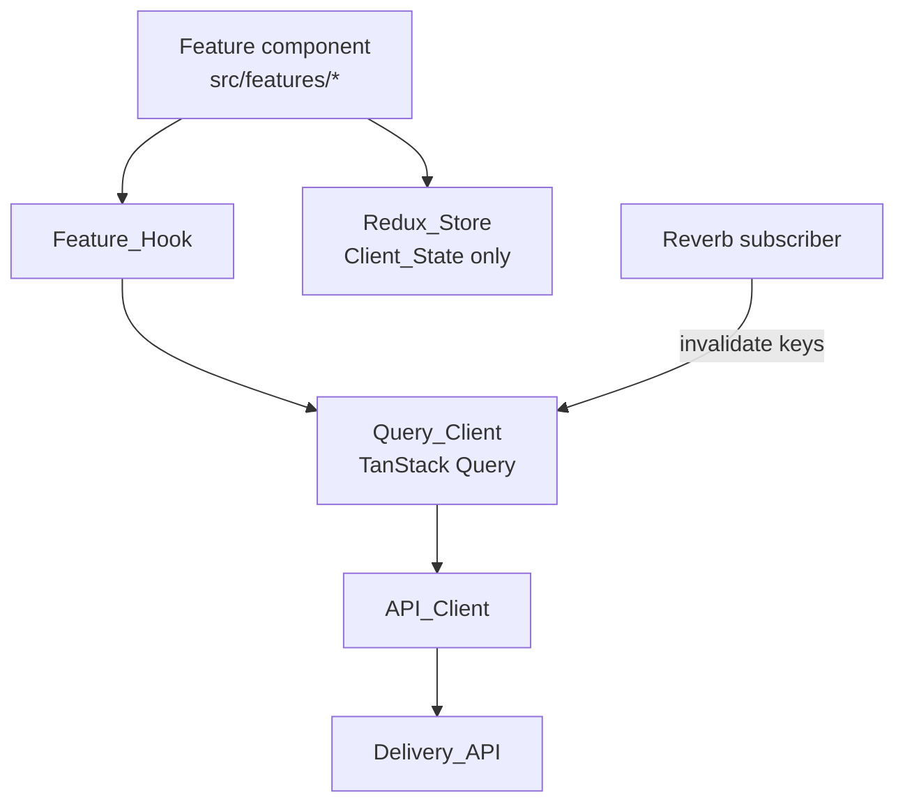

| Concern | Placement | Requirements |
| --- | --- | --- |
| Server_State | Query_Client only | 41.2, 41.6 |
| Client_State | Redux_Store or component state | 41.3 |
| HTTP access | `API_Client` only (base URL, bearer token, correlation header, API_Error decoding, single refresh-and-retry) | 41.5, 29.9, 29.10 |
| Query access | `Feature_Hook` only | 41.4 |
| Request/response types | generated from the OpenAPI_Document | 29.3 |
| Realtime | a subscriber that invalidates cache keys rather than writing state directly | 15.6, 42.7 |
| Cross-feature UI | `src/components`, no feature-to-feature imports | 41.10 |

The refresh flow lives in a single `API_Client` interceptor: on `401 invalid_token`, exchange the Refresh_Token once, retry the original request once, and on failure clear credentials and route to sign-in (Requirements 29.9, 29.10).

---

## Data Models

### Entity relationships

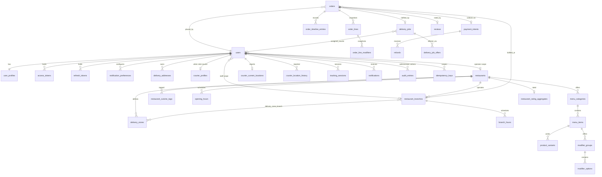

### Table catalog

Common conventions applied to every table (Requirement 40): single-column ULID `id` primary key (Requirement 40.1); every FK declared with an explicit `ON DELETE` behaviour (Requirement 40.2); `created_at`/`updated_at` as `timestamptz` in UTC (Requirement 40.7); every enumerated column as `varchar` with a `CHECK` restricting it to the Glossary value set (Requirement 40.5); every monetary column as `integer` with `CHECK (v BETWEEN 0 AND 99999999)` (Requirement 40.4); coordinates as `numeric(10,7)` and `numeric(11,7)`; every FK column indexed (Requirement 40.6).

**Auth**

| Table | Key columns | Constraints and indexes |
| --- | --- | --- |
| `users` | `email`, `email_lower`, `password_hash`, `role`, `account_status`, `restaurant_id?`, `restaurant_branch_id?` | `UNIQUE(email_lower)` (Req 40.3); `CHECK role IN (5 values)`; `CHECK account_status IN ('active','suspended')`; `CHECK` that `restaurant_id` is present iff role is `restaurant_operator` and `restaurant_branch_id` is present iff role is `restaurant_staff` |
| `access_tokens` | `user_id`, `token_hash`, `expires_at`, `revoked_at?`, `refresh_token_id?` | `UNIQUE(token_hash)`; index `(user_id, revoked_at)` |
| `refresh_tokens` | `user_id`, `token_hash`, `expires_at`, `revoked_at?`, `rotated_to_id?` | `UNIQUE(token_hash)`; index `(user_id, revoked_at)` |

**Account**

| Table | Key columns | Constraints and indexes |
| --- | --- | --- |
| `user_profiles` | `user_id`, `display_name`, `phone_encrypted?`, `default_delivery_address_id?` | `UNIQUE(user_id)` |
| `delivery_addresses` | `user_id`, `label`, `line1_encrypted`, `line2_encrypted?`, `locality_encrypted`, `postal_code_encrypted`, `country_code`, `latitude`, `longitude`, `is_default`, `archived_at?` | partial `UNIQUE(user_id) WHERE is_default AND archived_at IS NULL` (Reqs 31.9, 40.3); `CHECK` latitude/longitude ranges; index `(user_id, archived_at, label, id)` |
| `notification_preferences` | `user_id`, `category`, `channel`, `enabled` | `UNIQUE(user_id, category, channel)`; `CHECK` category and channel value sets |
| `email_change_tokens` | `user_id`, `new_email_lower`, `token_hash`, `expires_at`, `used_at?` | `UNIQUE(token_hash)`; index `(user_id, used_at)` |

**Catalog**

| Table | Key columns | Constraints and indexes |
| --- | --- | --- |
| `restaurants` | `name`, `description`, `status`, `time_zone`, `currency_code`, `tax_rate_basis_points`, `delivery_fee_base`, `delivery_fee_per_km`, `delivery_fee_min`, `delivery_fee_max`, `aggregate_rating?` | `CHECK status IN ('draft','pending_review','published','suspended')`; `CHECK tax_rate_basis_points BETWEEN 0 AND 3000`; `CHECK delivery_fee_min <= delivery_fee_max` (Req 59.1); index `(status, name, id)`; index on `aggregate_rating`; trigram index on `name` |
| `restaurant_cuisine_tags` | `restaurant_id`, `tag` | `UNIQUE(restaurant_id, tag)`; index `(tag)` |
| `restaurant_branches` | `restaurant_id`, `name`, address columns, `latitude`, `longitude`, `time_zone?`, `is_active` | index `(restaurant_id, is_active)`; coordinate `CHECK`s |
| `opening_hours` / `branch_hours` | owner id, `day_of_week`, `start_minute`, `end_minute` | `CHECK day_of_week IN (7 values)`; `CHECK start_minute < end_minute`; `CHECK` both in `[0,1440]`; `EXCLUDE USING gist` preventing overlap per owner and day (Reqs 11.7, 32.5) |
| `menu_categories` | `restaurant_id`, `name`, `display_order`, `archived_at?` | `CHECK display_order BETWEEN 0 AND 9999`; index `(restaurant_id, display_order, name)` |
| `menu_items` | `menu_category_id`, `name`, `description`, `price_minor`, `is_available`, `archived_at?` | `CHECK price_minor BETWEEN 1 AND 99999999` (Req 11.3); index `(menu_category_id, display_order, name)`; index `(is_available)` |
| `product_variants` | `menu_item_id`, `name`, `price_minor`, `is_available`, `display_order` | `CHECK price_minor >= 1`; index `(menu_item_id, display_order, name)` |
| `modifier_groups` | `menu_item_id`, `name`, `min_selections`, `max_selections`, `display_order` | `CHECK min_selections BETWEEN 0 AND 50`; `CHECK max_selections BETWEEN 1 AND 50`; `CHECK min_selections <= max_selections` (Req 11.4) |
| `modifier_options` | `modifier_group_id`, `name`, `price_delta_minor`, `display_order` | `CHECK price_delta_minor BETWEEN -99999999 AND 99999999` |

Collection limits (50 categories per menu, 200 items per category, 20 variants per item, 10 groups per item, 50 options per group, 50 branches per restaurant, 20 zones per branch, 20 staff per branch, 20 addresses per customer) are enforced in the owning Service_Implementation inside the write transaction with a `SELECT ... FOR UPDATE` on the parent row, which makes the count check race-free without a trigger (Requirements 11.10, 32.3, 32.13, 33.1, 33.11, 34.1, 31.7, 31.8).

**Zone**

| Table | Key columns | Constraints and indexes |
| --- | --- | --- |
| `delivery_zones` | `restaurant_id`, `name`, `geometry_geojson jsonb`, `geom geometry(Polygon,4326)` | GIST index on `geom`; `CHECK ST_IsValid(geom)` |
| `delivery_zone_branch` | `delivery_zone_id`, `restaurant_branch_id` | `UNIQUE(delivery_zone_id, restaurant_branch_id)`; both columns indexed |
| `geocode_cache` | `address_hash`, `latitude`, `longitude`, `resolved_at` | `UNIQUE(address_hash)` |

**Pricing**

| Table | Key columns | Constraints |
| --- | --- | --- |
| `promotions` | `code`, `restaurant_id?`, `discount_kind`, `discount_value`, `activates_at`, `expires_at`, `is_active` | `UNIQUE(lower(code))`; `CHECK activates_at < expires_at` (Req 18.4); `CHECK discount_kind IN ('amount','percent')`; `CHECK` value range per kind |
| `promotion_conditions` | `promotion_id`, `kind`, `operand` | index `(promotion_id)` |

**Order**

| Table | Key columns | Constraints and indexes |
| --- | --- | --- |
| `orders` | `order_number`, `customer_id`, `restaurant_id`, `restaurant_branch_id`, `state`, `delivery_address_snapshot jsonb`, `latitude`, `longitude`, `currency_code`, `line_subtotal`, `delivery_fee`, `service_fee`, `tax_amount`, `discount_amount`, `order_total`, `preparation_minutes?`, `rejection_reason?`, `cancellation_reason?`, `placed_at`, `delivered_at?` | `UNIQUE(order_number)` (Reqs 8.2, 40.3); `CHECK state IN (12 values)`; all six monetary `CHECK`s; `CHECK preparation_minutes BETWEEN 1 AND 240`; indexes `(customer_id, placed_at DESC)`, `(restaurant_id, state, placed_at)`, `(restaurant_branch_id, state, placed_at)`, `(state, placed_at)` (Req 40.6) |
| `order_lines` | `order_id`, `menu_item_id`, `variant_id?`, `item_name`, `variant_name?`, `base_price_minor`, `quantity`, `line_total_minor`, `unavailable_at_checkout` | `CHECK quantity BETWEEN 1 AND 20` (Req 40.4); index `(order_id)` |
| `order_line_modifiers` | `order_line_id`, `option_name`, `price_delta_minor` | index `(order_line_id)` |
| `order_timeline_entries` | `order_id`, `from_state?`, `to_state`, `actor_user_id?`, `actor_module?`, `note?`, `occurred_at` | append-only (no UPDATE path); `CHECK` exactly one of `actor_user_id`/`actor_module` is present; index `(order_id, occurred_at)` |
| `idempotency_keys` | `customer_id`, `idempotency_key`, `order_id?`, `response_status`, `response_body jsonb` | `UNIQUE(customer_id, idempotency_key)` (Reqs 8.3, 40.3) |

**Payment**

| Table | Key columns | Constraints |
| --- | --- | --- |
| `payment_intents` | `order_id`, `gateway`, `gateway_intent_id`, `amount_minor`, `currency_code`, `status`, `authorized_at?`, `captured_at?`, `voided_at?` | `UNIQUE(order_id)` (Req 9.1 — exactly one); `UNIQUE(gateway, gateway_intent_id)`; `CHECK status IN ('requires_authorization','authorized','captured','voided','declined','failed')` |
| `payment_events` | `gateway`, `provider_event_id`, `payload jsonb`, `processed_at` | `UNIQUE(gateway, provider_event_id)` (Req 9.7); index `(processed_at)` for the 7-day window |
| `refunds` | `payment_intent_id`, `amount_minor`, `status`, `gateway_refund_id?`, `failure_reason?` | partial `UNIQUE(payment_intent_id) WHERE status <> 'rejected'` (Req 9.8 — exactly one) |

**Dispatch**

| Table | Key columns | Constraints |
| --- | --- | --- |
| `delivery_jobs` | `order_id`, `assigned_courier_id?`, `pickup_lat/lng`, `dropoff_lat/lng`, `current_offer_radius_km`, `assigned_at?`, `closed_at?`, `outcome?`, `failure_reason?`, `escalated_at?` | `UNIQUE(order_id)` (Req 13.1); `CHECK outcome IN ('delivered','failed','cancelled')`; partial `UNIQUE(assigned_courier_id) WHERE closed_at IS NULL AND assigned_courier_id IS NOT NULL` (Req 13.7); indexes `(escalated_at)`, `(assigned_courier_id, closed_at DESC)`, `(outcome, created_at)` |
| `delivery_job_offers` | `delivery_job_id`, `courier_id`, `offered_at`, `withdrawn_at?`, `distance_km` | `UNIQUE(delivery_job_id, courier_id, offered_at)`; index `(courier_id, withdrawn_at)` |

**Rider, Tracking**

| Table | Key columns | Constraints |
| --- | --- | --- |
| `courier_profiles` | `user_id`, `rider_status`, `vehicle_type?`, `phone_encrypted?`, `vehicle_registration?`, `delivered_count` | `UNIQUE(user_id)`; `CHECK rider_status IN ('offline','online','on_delivery')`; `CHECK vehicle_type IN ('bicycle','motorcycle','car','on_foot')` |
| `courier_current_locations` | `courier_id`, `latitude`, `longitude`, `accuracy_metres`, `reported_at`, `accepted_at` | `UNIQUE(courier_id)` (Req 43.6); `CHECK accuracy_metres BETWEEN 0 AND 10000`; coordinate `CHECK`s |
| `courier_location_history` | `courier_id`, `delivery_job_id?`, coordinates, `reported_at` | index `(courier_id, reported_at DESC)`; index `(reported_at)` for the 30-day prune |
| `tracking_sessions` | `courier_id`, `opened_at`, `closed_at?` | partial `UNIQUE(courier_id) WHERE closed_at IS NULL` |

**Notification, Review, Admin**

| Table | Key columns | Constraints |
| --- | --- | --- |
| `notifications` | `user_id`, `category`, `channel`, `subject`, `body`, `payload jsonb`, `dispatched_at`, `delivery_status`, `read_at?` | `CHECK category IN (5 values)`; `CHECK channel IN ('email','in_app')`; `CHECK delivery_status IN ('queued','delivered','failed')`; index `(user_id, channel, dispatched_at DESC)` |
| `reviews` | `order_id`, `restaurant_id`, `customer_id`, `rating`, `body?`, `hidden_at?` | `UNIQUE(order_id)` (Reqs 17.3, 40.3); `CHECK rating BETWEEN 1 AND 5` (Req 40.4); index `(restaurant_id, hidden_at, created_at DESC)` |
| `restaurant_rating_aggregates` | `restaurant_id`, `visible_count`, `rating_sum`, `average_1dp?` | `UNIQUE(restaurant_id)` |
| `platform_configuration` | `service_fee_basis_points`, `service_fee_min`, `service_fee_max`, `initial_offer_radius_km`, `max_offer_radius_km`, `order_rejection_reasons jsonb`, `delivery_failure_reasons jsonb`, `notification_defaults jsonb` | single row enforced by `CHECK (id = 'singleton')`; `CHECK service_fee_basis_points BETWEEN 0 AND 2500`; `CHECK service_fee_min <= service_fee_max`; `CHECK` radii in `[1,20]` and `initial <= max` (Req 37.10) |
| `audit_entries` | `administrator_id`, `action`, `subject_type`, `subject_id`, `metadata jsonb`, `occurred_at` | index `(administrator_id, occurred_at DESC)`; index `(subject_type, subject_id)` |

### Order state machine

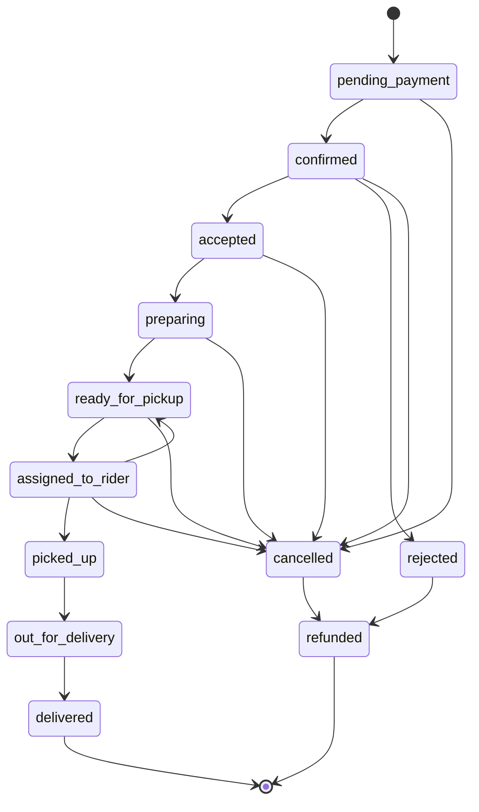

Exactly 18 edges over 12 states (Requirement 10.1). The edge table is data, not control flow, and is paired with an actor rule set per edge (Requirement 10.3):

| Edge | Permitted actors |
| --- | --- |
| `pending_payment→confirmed`, `pending_payment→cancelled`, `cancelled→refunded`, `rejected→refunded` | Payment_Module only |
| `confirmed→accepted`, `confirmed→rejected`, `accepted→preparing`, `preparing→ready_for_pickup` | Operator of fulfilling Restaurant, Staff of fulfilling Branch, Administrator |
| `ready_for_pickup→assigned_to_rider`, `assigned_to_rider→ready_for_pickup` | Dispatch_Module only |
| `assigned_to_rider→picked_up`, `picked_up→out_for_delivery`, `out_for_delivery→delivered` | Courier holding the active Delivery_Job, Administrator |
| `confirmed→cancelled` | placing Customer, Operator, Staff of fulfilling Branch, Administrator |
| `accepted→cancelled`, `preparing→cancelled`, `ready_for_pickup→cancelled`, `assigned_to_rider→cancelled` | Operator, Administrator |

### Restaurant status lifecycle

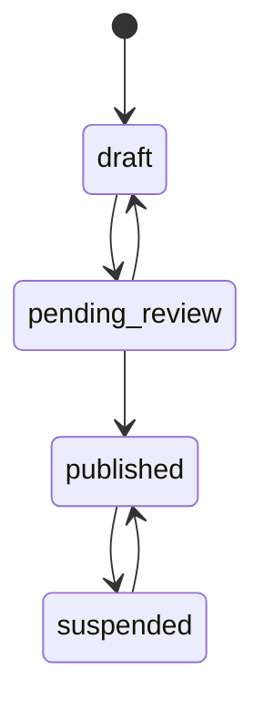

`pending_review→published` additionally requires at least one active branch, at least one available Menu_Item, and at least one zone assigned to an active branch; otherwise `409 restaurant_not_publishable` naming every unmet condition (Requirement 59.5).

### Enumerated value sets

| Name | Values |
| --- | --- |
| `Order_State` | `pending_payment`, `confirmed`, `accepted`, `preparing`, `ready_for_pickup`, `assigned_to_rider`, `picked_up`, `out_for_delivery`, `delivered`, `rejected`, `cancelled`, `refunded` |
| `Role` | `customer`, `restaurant_operator`, `restaurant_staff`, `courier`, `administrator` |
| `Account_Status` | `active`, `suspended` |
| `Restaurant_Status` | `draft`, `pending_review`, `published`, `suspended` |
| `Rider_Status` | `offline`, `online`, `on_delivery` |
| `Delivery_Job_Outcome` | `delivered`, `failed`, `cancelled` |
| `Notification_Category` | `order_status`, `delivery_status`, `payment`, `promotion`, `account` |
| Notification channel | `email`, `in_app` |
| `Task_Status` | `BACKLOG`, `READY`, `IN_PROGRESS`, `BLOCKED`, `READY_TO_TEST`, `TESTING`, `COMPLETED`, `DEFERRED`, `CANCELLED` |

### Redis structures

| Key | Type | TTL | Contents |
| --- | --- | --- | --- |
| `cart:v1:{customerId}` | string (JSON) | 72 h, reset on write | Cart document with ULID line ids |
| `menu:v1:{restaurantId}` | string (JSON) | 300 s | Menu read model |
| `search:v1:{queryHash}:{cursor}` | string (JSON) | 300 s | Restaurant search page |
| `signin_fail:{emailLower}` | counter | 15 min | failed sign-in attempts |
| `throttle:{scope}:{subject}` | counter | window | per-minute rate limits |
| `locrate:{courierId}` | string | 10 s | last accepted Location_Report marker |
| queue lists | list | — | `default`, `notifications`, `payments`, `dispatch`, `reports`, dead-letter |

### API envelope and error shapes

```json
// collection (Requirement 20.10, 20.15)
{ "data": [ /* resources */ ], "meta": { "total": 137, "next_cursor": "eyJ..." } }

// single resource
{ "data": { /* resource */ } }

// API_Error (Requirements 20.4, 28.1)
{ "error": { "code": "validation_failed",
             "message": "The request did not pass validation.",
             "fields": [ { "field": "quantity", "rule": "between:1,20" } ] } }

// money (Requirement 20.9)
{ "amount_minor": 1250, "currency": "EUR" }
```

Timestamps are ISO 8601 UTC with at least second precision (Requirement 20.8). Every resource has a symmetric decoder used by the serialization round-trip property (Requirement 20.7).

### Transactional write sequences

Requirement 40.8/40.9 requires one transaction per multi-table write. The documented sequences (mirrored in `docs/database/`, Requirement 55.8) are:

| Sequence | Steps inside one transaction | Requirements |
| --- | --- | --- |
| Registration | insert `users` → insert `user_profiles` → insert 10 `notification_preferences` rows | 1.1, 16.12 |
| Sign-in | insert `refresh_tokens` → insert `access_tokens` | 1.5 |
| Refresh rotation | revoke presented refresh token → insert new refresh token → insert new access token | 1.8 |
| Checkout | validate Cart → compute breakdown → insert `orders` → insert `order_lines` + `order_line_modifiers` → assign branch → insert `idempotency_keys` → append timeline entry | 8.1, 40.10 |
| State transition | lock order row → machine assert → update `orders.state` → append `order_timeline_entries` → record outbound domain event | 10.6, 10.15 |
| Payment capture | update `payment_intents` → append timeline entry | 9.10 |
| Refund | insert `refunds` → transition order to `refunded` (machine) → append timeline entry | 9.8 |
| Job assignment | conditional update `delivery_jobs` → withdraw sibling offers → set Rider_Status via boundary → transition order when `ready_for_pickup` | 13.3, 10.12, 35.3 |
| Location report | upsert `courier_current_locations` → insert `courier_location_history` | 43.6 |
| Review write | insert/update `reviews` → recompute `restaurant_rating_aggregates` | 17.4 |
| Default address | clear previous default → set new default | 31.9 |

Domain events are collected during the transaction and dispatched only after commit, so no subscriber can observe a state that a rollback then erases.

---

## Correctness Properties

*A property is a characteristic or behavior that should hold true across all valid executions of a system — essentially, a formal statement about what the system should do. Properties serve as the bridge between human-readable specifications and machine-verifiable correctness guarantees.*

Each property below is implemented by exactly one property-based test running at least 100 generated inputs, tagged as stated in the Testing Strategy. Acceptance criteria that classify as infrastructure checks, pipeline gates, documentation obligations, latency percentiles, or process governance are deliberately absent from this section and are covered by the unit, example, integration, and smoke suites instead.

### Property 1: Registration creates exactly one customer and never echoes credentials

*For any* valid registration triple (email ≤254 characters in `local@domain` form, password of 12–128 characters, display name of 1–100 characters), registration creates exactly one Platform user holding the single Role `customer`, returns that user's identifier, and produces a response body containing neither the submitted password nor any stored hash.

**Validates: Requirements 1.1, 1.4, 2.1**

### Property 2: Validation rejection is total, precise, and side-effect free

*For any* Delivery_API endpoint and any non-empty set of fields corrupted to violate that endpoint's declared schema, the response carries the HTTP status and API_Error code that endpoint documents for the violation (`validation_failed`, `invalid_price`, `invalid_modifier_group`, `invalid_hours`, `invalid_geojson`, or `invalid_location_report`), carries exactly one per-field detail for each violating field and no detail for any conforming field, and leaves every stored record byte-identical to its pre-request state.

**Validates: Requirements 1.2, 3.8, 6.9, 11.3, 11.4, 11.8, 11.9, 17.7, 18.4, 20.4, 28.1, 31.3, 32.6, 32.12, 37.8, 37.10, 43.5, 58.3, 59.2**

### Property 3: Email uniqueness is case-insensitive across every creation path

*For any* existing Platform user email address and any re-casing of that address, a registration, Restaurant_Staff creation, Administrator creation, or email-address change submitting the re-cased address is rejected with `email_already_registered`, creates no Platform user, issues no confirmation token, and leaves the existing Platform user unchanged.

**Validates: Requirements 1.3, 31.14, 33.9**

### Property 4: Token issuance, rotation, and revocation

*For any* sequence of sign-in, refresh, sign-out, password-change, and suspension operations over a Platform user, evaluated against an injected clock: an issued Access_Token expires exactly 60 minutes and an issued Refresh_Token exactly 30 days after issuance; after a refresh only the newest Refresh_Token is accepted and every earlier one is rejected with `invalid_refresh_token`; after sign-out both credentials of that session are rejected; after a password change every Refresh_Token except the presented one is rejected; and after suspension every credential of that Platform user is rejected.

**Validates: Requirements 1.5, 1.8, 1.9, 1.10, 1.11, 18.3, 31.5, 33.6**

### Property 5: Sign-in failures are indistinguishable and lockout is time-bounded

*For any* failed sign-in sequence, evaluated against an injected clock: an unknown email address and a wrong password produce identical status, API_Error code, and body; each failure increments the counter for the submitted address; from the 5th failure within any 15-minute window every further attempt for that address is rejected with `too_many_attempts` — including attempts carrying the correct password — and attempts are accepted again immediately after the 15-minute period, with the counter reset to 0.

**Validates: Requirements 1.6, 1.7**

### Property 6: Authorization conforms to the Role and ownership matrix

*For any* (endpoint, Role, resource-ownership) triple, the request succeeds exactly when the matrix of Requirements 2, 33, and 37 permits it; a request with no or malformed bearer credential is rejected with `unauthenticated`; a request whose stored Role lacks permission is rejected with `forbidden` carrying no field value of the target resource; authorization is decided from the Role stored in the database rather than from any token claim; and no rejected request changes any Platform data.

**Validates: Requirements 2.1, 2.2, 2.3, 2.10, 33.3, 33.4, 33.5, 37.2, 58.7**

### Property 7: Reads are scoped to the actor and non-existence is undisclosed

*For any* generated population of Orders, Delivery_Jobs, Delivery_Addresses, and Notifications and any actor, a single-record read returns the record exactly when the actor's scope rule holds (Customer: placed by; Restaurant_Operator: own Restaurant; Restaurant_Staff: own Restaurant_Branch; Courier: linked by an active Delivery_Job or delivered within the preceding 24 hours; Administrator: unrestricted); a list read returns exactly the set of individually readable records with a matching total count; and an out-of-scope identifier produces a response identical to that for a non-existent identifier, with no field value of the target present.

**Validates: Requirements 2.4, 2.5, 2.6, 2.7, 2.8, 2.9, 12.7, 12.8, 16.9, 31.11, 33.2, 33.10, 35.6, 35.9**

### Property 8: Cursor pagination partitions the result set exactly once

*For any* paginated collection endpoint, any generated result-set size, and any page size in the closed range 1 to 100 (defaulting to 20 when absent), walking every page concatenates to exactly the single-page ordering of that result set with no duplicate and no omitted record, every page reports the same total count of matching records, and the next-page cursor is present on every page except the final one, where it is null.

**Validates: Requirements 3.4, 16.9, 17.5, 19.1, 20.10, 20.15, 35.7, 37.1, 37.3, 37.4, 37.5**

### Property 9: Restaurant discovery returns exactly the qualifying set

*For any* generated catalog, any coordinate pair, and any combination of search term, cuisine, minimum-rating, and maximum-Delivery_Fee filters, the returned set equals the set of Restaurants whose Restaurant_Status is `published`, that hold at least one active Restaurant_Branch whose Serviceable_Area contains the coordinate pair (boundary points included), and that satisfy every supplied filter conjunctively, with Restaurants holding no Aggregate_Rating excluded whenever a minimum-rating filter is supplied.

**Validates: Requirements 3.1, 3.3, 17.8, 32.8**

### Property 10: Relevance ranking is a deterministic total order

*For any* generated Restaurant names and cuisine tags and any search term of 2–100 characters, the returned sequence is a permutation of the matching set sorted by descending relevance tier (full name match, name prefix match, name substring match, cuisine tag match) and, within a tier, by ascending name then ascending Restaurant identifier, and repeating the same request yields the identical sequence.

**Validates: Requirements 3.2**

### Property 11: Search cursors are authentic and expire

*For any* cursor that was not issued by the Catalog_Module, was tampered with, or was issued more than 15 minutes earlier under an injected clock, the request is rejected with `invalid_cursor` and returns no Restaurant.

**Validates: Requirements 3.9**

### Property 12: Menu read models are complete, ordered, and availability-preserving

*For any* generated Menu, the response contains every Menu_Category and every Menu_Item of that Menu — including items whose availability flag is false, marked unavailable and fully populated — ordered at both levels by ascending display-order value then ascending name; every Menu_Item carries its name, description, Price as integer minor units with the Restaurant's ISO 4217 currency code, availability flag, and every Modifier_Group with its Modifier_Options and signed Price_Deltas; and every returned Modifier_Group satisfies 0 ≤ minimum ≤ maximum ≤ 50 selections.

**Validates: Requirements 4.1, 4.2, 4.3, 4.4, 4.7**

### Property 13: Cached reads equal uncached reads and reflect every committed write

*For any* Menu or Restaurant search request, the response served from the Cache_Store is byte-identical to the response built from PostgreSQL, a cold read leaves a cache entry whose content equals the response with a 300-second expiry, and after any committed catalog write, availability change, Restaurant_Status change, or rating change the next read of every affected key returns the changed values.

**Validates: Requirements 4.5, 4.6, 4.8, 21.2, 21.3, 34.7, 59.7**

### Property 14: A Cache_Store failure degrades to PostgreSQL without failing the request

*For any* cached read endpoint executed while the Cache_Store is unreachable, the response equals the response produced with a healthy Cache_Store and the cache failure is recorded in the Observability_Stack.

**Validates: Requirements 21.4**

### Property 15: GeoJSON parsing accepts exactly the conforming grammar and reports the first violation

*For any* GeoJSON text describing 1–10 linear rings of 4–1,000 closed coordinate pairs within the latitude range -90 to 90 and longitude range -180 to 180 and at most 1,000,000 characters, the GeoJSON_Parser produces a geometry object structurally equal to the described polygon; and *for any* such text with exactly one violation injected at a known zero-based character offset, the parser rejects it with `invalid_geojson` reporting that offset and leaves every stored Delivery_Zone unchanged.

**Validates: Requirements 5.1, 5.2**

### Property 16: Geometry round-trips through the printer exactly

*For any* Delivery_Zone geometry object, parsing the output of the GeoJSON_Printer produces a geometry object equal to the original — the same rings in the same order, the same coordinate pairs in the same order within each ring, and coordinate values identical at 7 fractional digits — and every printed coordinate carries at most 7 fractional digits with each ring's first pair repeated as its last.

**Validates: Requirements 5.3, 5.4**

### Property 17: Printing is idempotent after normalization

*For any* GeoJSON text accepted by the GeoJSON_Parser, printing, parsing, and printing again yields text character-for-character identical to the first printed output.

**Validates: Requirements 5.5**

### Property 18: Containment is boundary-inclusive and implementation-agnostic

*For any* Delivery_Zone polygon with any number of interior rings and any probe coordinate pair — inside, outside, exactly on the exterior ring, or exactly on an interior ring — the Zone_Module treats the point as inside the Serviceable_Area exactly when it lies within the exterior ring of at least one zone assigned to an active Restaurant_Branch and outside every interior ring of that zone, boundary points counting as inside; the PostGIS containment query and the in-memory containment evaluator return the same decision for every generated point; a Restaurant with no assigned zones on active branches has an empty Serviceable_Area; and a Serviceable_Area equals the union of its assigned zones.

**Validates: Requirements 5.8, 5.9, 32.11**

### Property 19: Unserviceable and unresolvable addresses are rejected without side effects

*For any* postal address that the address resolver cannot match or that exceeds the 3,000-millisecond resolution budget, the request is rejected with `address_not_resolvable` and no Delivery_Address and no Restaurant_Branch is created or changed; and *for any* resolved coordinate pair outside the Serviceable_Area of the Cart's Restaurant, the request is rejected with `address_not_serviceable` and the Cart contents are unchanged. Every coordinate pair the resolver does return carries a latitude in -90 to 90, a longitude in -180 to 180, and at most 7 fractional digits.

**Validates: Requirements 5.6, 5.7, 5.10, 32.14**

### Property 20: Cart mutations preserve the Cart invariants

*For any* sequence of add, quantity-change, and remove operations over a Cart: every created Cart_Line records exactly the submitted Menu_Item, the selected Product_Variant where the Menu_Item defines variants, a quantity in 1–20, and the selected Modifier_Options; setting a quantity to 0 removes exactly that Cart_Line and leaves the others unchanged; every Cart holds lines from exactly one Restaurant, a cross-Restaurant add being rejected with `cart_restaurant_conflict`; a modifier selection outside a Modifier_Group's minimum or maximum is rejected with `invalid_modifier_selection`; an unknown Cart_Line or Menu_Item identifier is rejected with the mapped 404 code; and every rejection leaves the Cart byte-unchanged with its 72-hour expiry reset only on an accepted write.

**Validates: Requirements 6.1, 6.2, 6.3, 6.5, 6.6, 6.10**

### Property 21: Availability gates new selections and never alters existing records

*For any* Menu_Item or Product_Variant whose availability flag is false: adding it to a Cart is rejected with `item_unavailable` and creates no Cart_Line; an existing Cart_Line referencing it is returned marked unavailable with the Order_Total computed from the available Cart_Lines only; checkout is rejected with `item_unavailable` naming exactly the affected Menu_Item identifiers; every existing Order is unchanged; the cached Menu read model for that Restaurant is invalidated; and exactly one `menu_item.availability_changed` domain event is published carrying the Menu_Item identifier, the optional Product_Variant identifier, the new flag, and the UTC timestamp.

**Validates: Requirements 6.4, 8.5, 11.5, 34.5, 34.8, 34.9**

### Property 22: Variant selection rules are enforced exactly

*For any* Menu_Item: when it holds at least one Product_Variant, an add without exactly one selected variant is rejected with `variant_selection_required`, and an add selecting a variant of another Menu_Item or more than one variant is rejected with `invalid_variant_selection`, in both cases creating no Cart_Line; when it holds no Product_Variant, no variant selection is required.

**Validates: Requirements 34.3, 34.4**

### Property 23: Collection limits are enforced at the bound and nowhere else

*For any* bounded collection in the Platform (50 Cart_Lines per Cart, 50 Menu_Categories per Menu, 200 Menu_Items per Menu_Category, 20 Product_Variants per Menu_Item, 10 Modifier_Groups per Menu_Item, 50 Modifier_Options per Modifier_Group, 50 Restaurant_Branches per Restaurant, 20 Delivery_Zones per Restaurant_Branch, 20 active Restaurant_Staff per Restaurant_Branch, 20 non-archived Delivery_Addresses per Customer) and any current size, a create below the bound succeeds and a create at the bound is rejected with that collection's documented API_Error code creating no record, with archived records counting toward neither the bound nor the returned count.

**Validates: Requirements 6.8, 11.10, 31.7, 31.8, 32.3, 32.13, 33.1, 33.11, 34.1**

### Property 24: Pricing is integer-exact, component-correct, and deterministic

*For any* Cart of 0–50 Cart_Lines, any Restaurant pricing profile, any Platform_Configuration, and any Delivery_Address: Line_Subtotal equals the sum over available Cart_Lines of quantity × (base Price + selected Modifier_Option Price_Deltas), where the base Price is the selected Product_Variant Price when the Menu_Item defines variants and the Menu_Item Price otherwise; Delivery_Fee equals base + per-kilometre rate × min(distance, 20.000 km) with the distance rounded half up to 3 fractional digits, clamped to [minimum, maximum]; Service_Fee equals the configured percentage of Line_Subtotal clamped to its configured bounds; Tax_Amount equals the configured tax rate applied to Line_Subtotal + Delivery_Fee + Service_Fee before any discount; Order_Total equals Line_Subtotal + Delivery_Fee + Service_Fee + Tax_Amount − Discount_Amount and lies in 0 to 99,999,999 minor currency units; every computation is performed in integer minor units with exactly one half-up rounding step per produced value; and recomputation from identical inputs yields identical outputs. Where no Delivery_Address is selected, Delivery_Fee equals the configured minimum and the breakdown is marked provisional. Every returned breakdown carries all six components as integers plus the Restaurant's ISO 4217 currency code.

**Validates: Requirements 7.1, 7.2, 7.3, 7.4, 7.8, 7.9, 7.10, 7.12, 34.2**

### Property 25: Discount_Amount is clamped and ineligible Promotions change nothing

*For any* Cart and any Promotion: when exactly one code is supplied, the Promotion is active at the current UTC instant, and the Cart satisfies every eligibility condition, Discount_Amount equals the Promotion's computed value clamped to the closed range 0 to Line_Subtotal + Delivery_Fee; and when the code is unknown, outside its activation window, ineligible, or supplied together with any further code, the request is rejected with `promotion_not_applicable`, Discount_Amount is 0, and the Cart contents are unchanged.

**Validates: Requirements 7.5, 7.6, 7.7**

### Property 26: Checkout is idempotent per Customer and Idempotency_Key

*For any* checkout request and any number of repetitions of the same (Customer, Idempotency_Key) pair, including concurrent repetitions, exactly one Order is created and every response returns that Order with the original HTTP status.

**Validates: Requirements 8.3**

### Property 27: Order_Numbers are well-formed and unique

*For any* number of generated Orders, every Order_Number is exactly 10 characters drawn from the uppercase alphanumeric alphabet and the set of Order_Numbers has the same cardinality as the set of Orders.

**Validates: Requirements 8.2**

### Property 28: Order snapshots are immutable under later catalog change

*For any* placed Order and any subsequent change to the referenced Menu_Items, Product_Variants, Modifier_Options, Prices, or Delivery_Address, every Order_Line snapshot (item name, variant name, base Price, Modifier_Option names and Price_Deltas, quantity), the stored price breakdown, and the Order's address snapshot remain byte-identical to their values at Order creation.

**Validates: Requirements 8.1, 8.7, 31.10, 34.10**

### Property 29: The fulfilling Restaurant_Branch is selected deterministically

*For any* Cart, Delivery_Address, and branch layout — including exact distance ties — the Order is assigned exactly one fulfilling Restaurant_Branch, being the candidate at the shortest straight-line distance among the Restaurant_Branches that are active, open per the hours rule, and holding a Serviceable_Area containing the Delivery_Address coordinate pair, with ties broken by ascending Restaurant_Branch identifier; when every active Restaurant_Branch is closed the request is rejected with `restaurant_closed`, when at least one is open but none services the address the request is rejected with `no_branch_available`, and in both cases no Order is created.

**Validates: Requirements 8.4, 32.9, 32.10**

### Property 30: Open-or-closed status is half-open interval membership in the applicable time zone

*For any* weekly schedule of at most 3 non-overlapping intervals per day of week expressed as minutes from local midnight, any IANA time zone (including days crossing a daylight-saving transition), and any UTC probe instant, a Restaurant_Branch is reported open exactly when the instant converted into the applicable time zone falls in [start, end) of an interval of that Restaurant_Branch's Branch_Hours where at least one interval is defined, and of the Restaurant's Opening_Hours otherwise, and is reported closed whenever no applicable interval contains the instant, including days with no defined interval.

**Validates: Requirements 11.7, 32.5, 32.7, 3.5**

### Property 31: Submitted schedules replace the stored schedule atomically

*For any* submitted weekly schedule, an accepted submission replaces the complete stored weekly schedule of that owner with exactly the submitted intervals, and a submission violating any interval rule leaves the stored schedule byte-unchanged with no interval of the submitted schedule applied.

**Validates: Requirements 11.7, 11.8, 32.5, 32.6**

### Property 32: The Order_State_Machine permits exactly the 18 edges

*For any* ordered pair of Order_States, the Order_State_Machine permits the transition exactly when the pair is one of the 18 edges of Requirement 10 criterion 1; `delivered` and `refunded` have no outgoing edge; `cancelled` and `rejected` have exactly one outgoing edge, to `refunded`; and no code path other than the Order_State_Machine changes an Order_State.

**Validates: Requirements 10.1, 10.2, 10.7, 10.8**

### Property 33: Transition refusals evaluate membership before actor permission

*For any* (Order_State pair, actor) combination: a pair absent from the permitted edge set is rejected with `invalid_state_transition` regardless of the actor; a permitted pair requested by an actor outside that edge's permitted actor set is rejected with `forbidden`; a Customer cancellation is accepted only from `confirmed` and otherwise rejected with `cancellation_window_closed`; and every rejection leaves the Order_State and the Order_Timeline unchanged and publishes no Realtime_Event and no Notification.

**Validates: Requirements 10.3, 10.4, 10.5, 10.9, 10.10, 33.4, 33.5, 35.10**

### Property 34: Every successful transition appends one timeline entry, publishes one event, and sends exactly the mapped Notifications

*For any* sequence of successful Order_State transitions, each transition appends exactly one Order_Timeline entry recording the previous Order_State, the new Order_State, the acting Platform user identifier or module name, and the UTC timestamp; publishes exactly one `order.state_changed` domain event whose target channel set is the Order channel, the fulfilling Restaurant_Branch channel, and, where a Delivery_Job is assigned, the assigned Courier channel; and produces exactly the Notification set that Requirement 16 maps to the new Order_State and no other Notification. The Order_Timeline is append-only: earlier entries are never modified or removed.

**Validates: Requirements 10.6, 10.11, 10.15, 10.16, 12.1, 16.1, 16.7, 33.7**

### Property 35: Assignment, readiness, and withdrawal drive the Order_State automatically

*For any* ordering of Delivery_Job assignment, `ready_for_pickup` arrival, and assignment withdrawal: an assignment while the Order is `ready_for_pickup` transitions the Order to `assigned_to_rider`; an Order assigned while `accepted` or `preparing` transitions to `assigned_to_rider` on reaching `ready_for_pickup`; a withdrawal while `assigned_to_rider` returns the Order to `ready_for_pickup`; and the Courier's Rider_Status follows assignment to `on_delivery` and closure or withdrawal back to `online`.

**Validates: Requirements 10.12, 10.13, 10.14, 35.3, 35.8**

### Property 36: Restaurant order handling records exactly what was submitted

*For any* Order in a state permitting the action and any permitted Restaurant actor, accepting records a preparation time in whole minutes within 1–240 and transitions to `accepted`, rejecting records a reason drawn from the Platform_Configuration rejection list and transitions to `rejected`, marking in preparation transitions to `preparing`, and marking ready transitions to `ready_for_pickup`; a preparation time outside 1–240 or a reason outside the configured list is rejected and changes nothing.

**Validates: Requirements 12.2, 12.3, 12.4, 12.5**

### Property 37: Time-driven reminder and escalation schedules are exact and bounded

*For any* dwell time of an Order in `confirmed` and any Delivery_Job offer history, evaluated against an injected clock: the un-accepted-Order reminder is first sent at 10 minutes and then at 5-minute intervals, stopping at the earlier of leaving `confirmed` and 6 reminders; the Offer_Radius widens once at 120 seconds to the configured maximum and never beyond it, re-offering at 120-second intervals; at 600 seconds since the Delivery_Job creation timestamp every outstanding offer is withdrawn, no further offer is issued, the Delivery_Job is marked escalated in the Administrator_Queue, the associated Order keeps its Order_State, and exactly one Administrator Notification is sent within 60 seconds; and a reported delivery failure with a reason from the configured failure list closes the Delivery_Job with outcome `failed`, escalates it, retains the Order_State, and notifies the Administrator within 60 seconds.

**Validates: Requirements 12.6, 13.5, 13.6, 14.8**

### Property 38: The offered Courier set is exactly the nearest Available_Couriers in radius

*For any* generated Courier population with varied Rider_Status, Account_Status, most-recent-Courier_Location age, and active-Delivery_Job state, and any Pickup_Location: a Courier is classified as an Available_Courier exactly when Rider_Status is `online`, Account_Status is `active`, the most recent Courier_Location carries a timestamp not older than 5 minutes, and the Courier holds no active Delivery_Job; the offered set is the at most 10 nearest such Couriers within the current Offer_Radius ordered by ascending straight-line distance; the SQL candidate query and the in-memory classifier agree for every generated Courier; and when the set is empty the Delivery_Job stays unassigned and availability is re-evaluated at 30-second intervals.

**Validates: Requirements 13.2, 13.8, 13.10**

### Property 39: Delivery_Job assignment has exactly one winner and one active job per Courier

*For any* number of concurrent accepts of one offered Delivery_Job, exactly one accept is recorded as the assignment, every other accept is rejected with `job_already_assigned`, every remaining offer is withdrawn, an accept by a Courier already holding an active Delivery_Job is rejected with `courier_has_active_job` leaving that Courier's active Delivery_Job unchanged, and at no point does any Courier hold more than one active Delivery_Job.

**Validates: Requirements 13.1, 13.3, 13.4, 13.7, 13.11**

### Property 40: Courier execution actions are guarded and close the Delivery_Job correctly

*For any* (Courier, Delivery_Job, action) triple: an action on a Delivery_Job not assigned to that Courier is rejected with `delivery_not_found` leaving the Delivery_Job and Order unchanged; pickup, start, and delivered actions from a permitted Order_State transition the Order to `picked_up`, `out_for_delivery`, and `delivered` respectively, the delivered action closing the Delivery_Job with outcome `delivered`; and an action from a state the Order_State_Machine forbids is rejected with `invalid_state_transition` leaving the Order_State unchanged.

**Validates: Requirements 14.1, 14.2, 14.6, 35.9, 35.10**

### Property 41: Location_Report acceptance is a fixed composed predicate

*For any* Location_Report and any Courier state, evaluated against an injected clock, the report is accepted exactly when every clause holds — required fields present, latitude in -90 to 90, longitude in -180 to 180, accuracy in 0 to 10,000 metres, timestamp not more than 60 seconds after and not more than 300 seconds before receipt, Rider_Status in {`online`, `on_delivery`}, and at least 10 seconds since that Courier's most recently accepted report — and is otherwise rejected with `invalid_location_report` for a field or window violation, `rider_offline` for an offline Courier, or `location_report_rate_exceeded` for a too-frequent report, storing no Courier_Location in every rejecting case.

**Validates: Requirements 14.3, 14.4, 43.4, 43.5, 43.9**

### Property 42: Accepted reports produce ordered effects and rejected reports produce none

*For any* Location_Report: on acceptance the Tracking_Module writes exactly one most-recent Courier_Location row for that Courier holding the reported values, appends exactly one history record, then publishes the domain event, then broadcasts `courier.location_updated`, in that order; on rejection it persists no Courier_Location, publishes no domain event, and broadcasts no Realtime_Event.

**Validates: Requirements 14.5, 42.3, 42.4, 43.6**

### Property 43: Courier_Location retention keeps exactly the last 30 days

*For any* generated Courier_Location history with report ages straddling the 30-day boundary, after the retention prune the retained set is exactly the records whose age is at most 30 days since Delivery_Job closure.

**Validates: Requirements 14.7**

### Property 44: Rider_Status transitions respect profile completeness and active work

*For any* sequence of Rider_Status actions: a newly created Courier holds `offline` with no vehicle type and no closed Delivery_Job; going `online` succeeds only when the Courier profile holds a vehicle type and a phone number and the Courier holds no active Delivery_Job, otherwise `courier_profile_incomplete`; going `offline` while holding an active Delivery_Job is rejected with `active_delivery_in_progress` leaving the Rider_Status unchanged; a successful `online` opens exactly one Tracking_Session and a successful `offline` closes it; and an Administrator suspension forces `offline` when the Courier holds no active Delivery_Job and leaves the Rider_Status unchanged when it does, issuing no further offer either way.

**Validates: Requirements 35.1, 35.2, 35.4, 35.5, 58.1, 58.4, 58.6**

### Property 45: Payment outcomes map one-to-one onto Order_States and money movements

*For any* Order and any Payment_Gateway verdict sequence: exactly one Payment_Intent is created per Order for the Order_Total in integer minor units and the Order's currency, with the returned identifier recorded on the Order; a successful authorization transitions the Order to `confirmed` and captures the full authorized amount exactly once with a timeline record; a decline or an exhausted retry sequence transitions the Order to `cancelled` with the reason on the timeline and creates no further Payment_Intent; a captured Payment_Intent on an Order reaching `cancelled` or `rejected` produces exactly one Refund for the captured amount and then `refunded`; an authorized but uncaptured Payment_Intent instead produces a void with no Refund and then `refunded`; a rejected Refund leaves the Order in `cancelled` or `rejected` with the failure reason on the timeline; retries number at most 3 with waits of 1, 2, and 4 seconds, the Order remaining in `pending_payment` throughout; and the Idempotency_Key sent to the gateway is a function of the Order identifier alone, identical across the initial request and every retry.

**Validates: Requirements 9.1, 9.2, 9.3, 9.4, 9.8, 9.9, 9.10, 9.11, 9.12, 9.14**

### Property 46: Webhook processing is signature-gated and idempotent

*For any* webhook envelope: no Order_State change, capture, Refund, or Order_Timeline entry occurs unless signature verification succeeds, an invalid signature producing HTTP status 400 with the Order untouched and the rejection recorded; and *for any* number of repetitions of a webhook whose event identifier was processed within the preceding 7 days, the additional deliveries are acknowledged while producing no second state change, capture, Refund, or timeline entry.

**Validates: Requirements 9.5, 9.6, 9.7**

### Property 47: Every bound Payment_Gateway adapter satisfies the same contract deterministically

*For any* registered Payment_Gateway adapter and any authorize, capture, refund, or webhook-verification input, the adapter satisfies every criterion of Requirement 9 without a change to Order_Module, Cart_Module, or Web_Client code; and the Simulated_Payment_Gateway returns the identical outcome for identical inputs on every invocation while making no outbound network call.

**Validates: Requirements 9.13, 36.4, 36.8**

### Property 48: Notifications are category-tagged and preference-gated

*For any* notifiable event and any recipient Notification preference matrix, each produced Notification carries exactly one Notification_Category from the five permitted values, is sent only on channels the recipient leaves enabled for that category, is recorded with recipient identifier, category, channel, and UTC dispatch timestamp, and a Notification of a disabled category and channel combination is never sent; a newly created Platform user holds the Platform_Configuration defaults for every category and channel pair.

**Validates: Requirements 16.4, 16.5, 16.11, 16.12**

### Property 49: Notification delivery is queued, bounded-retry, and outcome-recorded

*For any* Notification and any delivery failure count, dispatch occurs through a queued Job so the originating request completes independently, delivery is retried at most 3 times with waits of 1, 2, and 4 seconds, the final outcome is recorded as delivered or failed, `email` Notifications go through the configured mail transport, and `in_app` Notifications are persisted as records retrievable only by their recipient with a read flag that `markRead` sets to true without altering the Notification content.

**Validates: Requirements 16.2, 16.3, 16.6, 16.8, 16.9, 16.10**

### Property 50: Reviews are once-per-delivered-own-Order and ratings aggregate exactly

*For any* (Order, Customer, prior-review) combination, a Review is stored exactly when the Order is in Order_State `delivered`, was placed by that Customer, and holds no Review, with a rating in 1–5 and text of at most 1,000 characters; otherwise the request is rejected with `order_not_reviewable`, `review_already_exists`, or `validation_failed` and stores no Review. *For any* sequence of Review writes and hides, the Restaurant's Aggregate_Rating equals the arithmetic mean of its Customer-visible Review ratings rounded half up to 1 decimal place, is reported absent when no Customer-visible Review exists, and a hidden Review appears in no Customer-facing response.

**Validates: Requirements 17.1, 17.2, 17.3, 17.4, 17.6, 17.8**

### Property 51: Restaurant_Status transitions are constrained and publication is conditional

*For any* ordered pair of Restaurant_Statuses, the transition is permitted exactly when it is one of `draft`→`pending_review`, `pending_review`→`published`, `pending_review`→`draft`, `published`→`suspended`, `suspended`→`published`, any other pair being rejected with `invalid_status_transition` leaving the Restaurant_Status unchanged; a transition to `published` additionally requires at least one active Restaurant_Branch, at least one available Menu_Item, and at least one Delivery_Zone assigned to an active Restaurant_Branch, otherwise it is rejected with `restaurant_not_publishable` naming every unmet condition; a created Restaurant holds `draft`; suspension removes the Restaurant from Customer-facing results and rejects checkout with `restaurant_suspended` while every existing Order keeps its Order_State and every permitted transition; and publication makes the Restaurant visible in Customer-facing results.

**Validates: Requirements 18.1, 18.2, 59.1, 59.3, 59.4, 59.5, 59.6, 59.8**

### Property 52: A published Restaurant always retains an active Restaurant_Branch

*For any* sequence of Restaurant_Branch activation changes on a Restaurant whose Restaurant_Status is `published`, deactivating the last active Restaurant_Branch is rejected with `last_active_branch` leaving that Restaurant_Branch unchanged, so at least one active Restaurant_Branch exists at every observable point.

**Validates: Requirements 32.4, 32.3**

### Property 53: Every Administrator write produces exactly one complete Audit_Entry

*For any* Administrator write action across any module, exactly one Audit_Entry is recorded holding the Administrator identifier, the action name, the affected record identifier, and the UTC timestamp — carrying the previous and new Restaurant_Status for a Restaurant_Status change — and no Audit_Entry is recorded for a rejected action.

**Validates: Requirements 18.6, 37.9, 59.9**

### Property 54: Administrator Reports equal a reference aggregation over the requested range

*For any* generated Order and Delivery_Job population and any date range of at most 366 days, the Report's Order counts by Order_State, gross Order_Total sum, mean delivery duration in whole seconds, failed Delivery_Job count, and Order count by Restaurant equal the values computed by a straightforward reference aggregation restricted to that range; a range longer than 366 days, an inverted range, or a start earlier than the earliest Order creation timestamp minus one day is rejected with `validation_failed` returning no Report.

**Validates: Requirements 18.7, 37.7, 37.8**

### Property 55: Administrator list filters are conjunctive and complete

*For any* generated population and any combination of the documented filters (Role, Account_Status, email substring, Restaurant_Status, name substring, Rider_Status, assignment state, Administrator_Queue presence, Delivery_Job_Outcome, Courier, Order_State, Restaurant, creation-date range), the returned set equals exactly the records satisfying every supplied filter, with each record carrying the projected fields the requirement states and no stored password hash.

**Validates: Requirements 18.5, 37.1, 37.3, 37.4, 37.5**

### Property 56: Platform_Configuration applies to every request after commit

*For any* accepted Platform_Configuration update, every Delivery_API request received after the commit computes Service_Fee bounds, Offer_Radii, rejection reasons, failure reasons, and Notification defaults from the new values, and a rejected update leaves every stored value unchanged.

**Validates: Requirements 37.9, 37.10**

### Property 57: Reorder carries exactly the still-available lines and names the omissions

*For any* past Order and any availability mask over its referenced Menu_Items and Product_Variants, the created Cart holds exactly one Cart_Line per Order_Line whose Menu_Item and, where named, selected Product_Variant remain available, and the response lists exactly the omitted Order_Lines.

**Validates: Requirements 19.3**

### Property 58: Delivery_API resources round-trip through serialization

*For all* Delivery_API resource objects, deserializing the serialized representation produces a resource object equal to the original.

**Validates: Requirements 20.7**

### Property 59: Every response obeys the API conventions

*For any* Delivery_API request and outcome, the HTTP status equals the documented mapping (200 read, 201 creation, 204 deletion, 401 unauthenticated, 403 unauthorized, 404 missing, 409 conflict, 422 validation, 429 rate limit), every timestamp is an ISO 8601 UTC string with second precision or finer, every monetary value is an integer number of minor currency units accompanied by an ISO 4217 currency code, every collection is returned in the data/total/next-cursor envelope, and the four security headers `Strict-Transport-Security`, `X-Content-Type-Options`, `X-Frame-Options`, and `Content-Security-Policy` are present.

**Validates: Requirements 20.3, 20.8, 20.9, 20.10, 28.9**

### Property 60: Responses do not depend on the calling client

*For any* request, issuing it with differing client-identifying headers produces identical responses once the Correlation_Identifier is excluded from the comparison.

**Validates: Requirements 20.13**

### Property 61: The Correlation_Identifier is echoed or generated and propagated everywhere

*For any* request, the Delivery_API uses a supplied Correlation_Identifier header or generates one, returns it in the response headers, and includes that identical value in every log entry, every queued Job, and every Realtime_Event produced by that request.

**Validates: Requirements 27.4, 27.5**

### Property 62: Logs are structured and free of secrets

*For any* request, including requests carrying passwords, Access_Tokens, Refresh_Tokens, and payment instrument values in bodies, headers, or query strings, every emitted log entry is a single-line JSON object carrying a UTC timestamp, a severity level, a message, the Correlation_Identifier, and the acting Platform user identifier where authenticated, and contains none of those secret values; an unhandled exception yields an API_Error with code `internal_error` whose body excludes the stack trace while the trace is recorded in the Observability_Stack.

**Validates: Requirements 27.3, 27.7, 27.9**

### Property 63: Rate limits are enforced per scope with a Retry-After header

*For any* request sequence within one minute, an authenticated Platform user is permitted 60 requests per endpoint group and an unauthenticated client 20 requests on authentication endpoints, further requests being rejected with HTTP status 429 and a `Retry-After` header, and this limiting is independent of the failed sign-in attempt limit.

**Validates: Requirements 28.3**

### Property 64: Cross-origin requests are restricted to configured origins

*For any* request origin, cross-origin access is granted exactly when the origin is in the configured Web_Client origin list.

**Validates: Requirements 28.4**

### Property 65: Stored personal data is encrypted and recoverable, and anonymization is complete

*For any* Delivery_Address value and Platform user contact detail, the value stored in PostgreSQL differs from the plaintext and reading it back through the application yields the original value exactly; and *for any* Platform user with Orders, account deletion clears or pseudonymizes every personal field of that Platform user while every Order record survives in anonymized form.

**Validates: Requirements 28.6, 28.7**

### Property 66: User input is stored and returned literally, never interpreted

*For any* string field and any SQL-injection-shaped or control-character-bearing input accepted by that field's schema, the value is persisted and returned unchanged and no statement is composed by interpolation.

**Validates: Requirements 28.2**

### Property 67: Queued Jobs are idempotent and bounded in retries

*For any* queued Job payload and any number of repeated executions, the stored state after n executions equals the stored state after exactly one execution; and *for any* failure count, a failing Job is retried at most 3 times with waits of 1, 2, and 4 seconds, then moved to the dead-letter queue with an error-level Observability_Stack entry naming the Job and the failure reason.

**Validates: Requirements 21.6, 21.7, 21.8**

### Property 68: Multi-table writes are atomic and name the failed step

*For any* multi-table write sequence in the Platform and any step chosen as the failure point, every affected table is byte-identical to its pre-transaction state, the response carries an API_Error naming the failed step, and for checkout specifically no Order and no Order_Line is persisted and the Cart contents are unchanged; a Cart is deleted only on the transition to Order_State `confirmed`, and a failure occurring after the checkout transaction commits leaves the Order in `pending_payment` or transitions it to `cancelled` through the Order_State_Machine and in no other Order_State.

**Validates: Requirements 8.6, 8.8, 40.8, 40.9, 40.10**

### Property 69: Database constraints reject invalid rows even when the application is bypassed

*For any* direct database write violating a documented constraint — monetary value outside 0 to 99,999,999, latitude outside -90 to 90, longitude outside -180 to 180, rating outside 1 to 5, Cart_Line or Order_Line quantity outside 1 to 20, an enumerated value outside its Glossary set, or a duplicate of a value combination required to be unique (email compared case-insensitively, Order_Number, Idempotency_Key per Customer, Review per Order, default Delivery_Address per Customer) — the write fails at the database level.

**Validates: Requirements 40.3, 40.4, 40.5, 40.12**

### Property 70: Delivery_Address defaults and archival keep their invariants

*For any* sequence of Delivery_Address create, mark-default, and delete operations for a Customer, at most one non-archived Delivery_Address holds the default flag at every observable point; a created Delivery_Address is default exactly when the Customer holds no other non-archived Delivery_Address; deleting a Delivery_Address archives it, excludes it from the list, clears the default flag when it held it, leaves the Customer with no default until another is marked, preserves every referencing Order's address snapshot, and makes no further change when the target is already archived; and the list returns non-archived Delivery_Addresses ordered with the default first and the remainder by ascending label then ascending identifier.

**Validates: Requirements 31.7, 31.9, 31.10, 31.11**

### Property 71: Partial profile updates change exactly the submitted fields

*For any* profile or Courier profile update submitting any subset of the updatable fields, exactly those fields hold the submitted values afterwards, an empty phone number clears the stored phone number, every unsubmitted field and the stored email address and password hash are byte-unchanged, and the own-profile view returns every documented field while excluding the stored password hash and every email-change confirmation token.

**Validates: Requirements 31.1, 31.2, 58.2, 58.5**

### Property 72: The email-change token flow preserves sign-in continuity

*For any* sequence of email-change requests and confirmations, issuing a token invalidates every previously issued email-change token of that Customer, the stored email address and sign-in behaviour keep using the previous address until a valid token is accepted, accepting a recorded unused unexpired token within 24 hours replaces exactly the email address leaving password hash, display name, phone number, and Notification preferences unchanged, and an unknown, used, or expired token is rejected with `invalid_confirmation_token` leaving the stored email address unchanged.

**Validates: Requirements 31.4, 31.12, 31.13**

### Property 73: Password change succeeds only against the stored hash

*For any* password change request, the stored hash is replaced exactly when the submitted current password matches the stored hash and the new password is 12–128 characters; a mismatch yields `current_password_mismatch` and an out-of-range new password yields `validation_failed`, in both cases leaving the stored hash unchanged and invalidating no Refresh_Token.

**Validates: Requirements 31.5, 31.6**

### Property 74: Realtime channel authorization equals resource authorization

*For any* actor and any Private_Channel, the subscription is authorized exactly when the same actor's read of the corresponding Delivery_API resource would be authorized, an unauthorized subscription being refused with `channel_forbidden`, so no subscriber receives an event it could not read over REST.

**Validates: Requirements 15.2, 15.3, 33.7**

### Property 75: Only the five permitted Realtime_Events are ever broadcast

*For any* generated activity sequence over the Platform, every broadcast event name lies in {`order.created`, `order.state_changed`, `courier.location_updated`, `delivery.state_changed`, `notification.created`} and each of the five is reachable by some activity.

**Validates: Requirements 42.2**

### Property 76: A failing Realtime_Gateway never changes persisted state or request outcome

*For any* request that publishes a domain event, executing it with an unreachable Realtime_Gateway completes with the same HTTP status and response body and leaves the persisted state byte-identical to execution with a healthy Realtime_Gateway, with the broadcast failure recorded in the Observability_Stack.

**Validates: Requirements 42.6**

### Property 77: The Web_Client renders API_Errors with per-field detail

*For any* API_Error payload with any set of per-field validation details, the Web_Client displays the error message and marks each named field with its corresponding rule message, marking no field absent from the payload.

**Validates: Requirements 29.4**

### Property 78: Server_State status drives loading and submit-control state

*For any* Delivery_API request lifecycle and settle outcome, the Web_Client shows a loading indicator for the affected region while the request is in flight, keeps the submit control disabled until the request settles, and derives every loading, error, and empty-state display from the Query_Client status for that Server_State with no duplicate flag held in the Redux_Store.

**Validates: Requirements 29.5, 41.6**

### Property 79: Token refresh is attempted exactly once per failed request

*For any* sequence of `401 invalid_token` responses and Refresh_Token exchange outcomes, the Web_Client performs exactly one refresh and one retry per failed request, and on a failed exchange clears the stored credentials and presents the sign-in screen.

**Validates: Requirements 29.9, 29.10**

### Property 80: Successful mutations invalidate exactly the affected cache keys

*For any* Web_Client mutation that changes Server_State, every Query_Client cache key whose data the mutation changed is invalidated and every unaffected key remains valid.

**Validates: Requirements 41.7**

### Property 81: WebSocket reconnection backs off exponentially to a 30-second cap

*For any* number of consecutive connection drops, the nth reconnection delay equals min(2^(n−1), 30) seconds starting at 1 second, and the delay never exceeds 30 seconds.

**Validates: Requirements 15.5**

### Property 82: Active Order display tracks the Order_State

*For any* Order_State and any presence or absence of a recent Courier_Location, the Web_Client displays the current Order_State, and displays the most recent Courier_Location on a map exactly when the Order_State is `assigned_to_rider`, `picked_up`, or `out_for_delivery` and a Courier_Location exists.

**Validates: Requirements 29.6**

---

## Error Handling

### One error shape, one place that renders it

Every failure leaves the Delivery_API as an API_Error in the envelope of the Data Models section. Domain code throws typed exceptions carrying a stable code, an HTTP status, and optional field details; a single exception handler maps them to responses. No Controller composes an error body, which is what keeps Requirement 20.4 satisfiable for every endpoint at once.

```php
abstract class DomainException extends \RuntimeException {
    abstract public function errorCode(): string;      // stable, documented in the OpenAPI_Document
    abstract public function httpStatus(): int;
    public function fieldErrors(): array { return []; }
    public function context(): array { return []; }     // logged, never returned
}
```

Three families exist: `ValidationException` (422, carries field details), `ConflictException` (409), and `AuthorizationException` (401/403/404 depending on whether disclosure is permitted). Anything else reaching the handler is logged with its stack trace and returned as `internal_error` with HTTP status 500 and no trace in the body (Requirement 27.9).

### Rejection ordering

Ordering is part of the contract, because several requirements distinguish outcomes that would otherwise overlap. The fixed order is:

1. Correlation and security middleware (never rejects).
2. Authentication — `401 unauthenticated` for absent or malformed credentials, `401 invalid_token` for revoked or expired ones (Requirements 1.11, 2.2).
3. Rate limiting — `429` with `Retry-After` (Requirement 28.3); the sign-in lockout of Requirement 1.7 is evaluated inside the Auth service and is independent.
4. Form_Request schema validation — `422 validation_failed` before any Service_Implementation runs (Requirements 28.1, 38.3).
5. Authorization — `403 forbidden`, or `404` where disclosure is prohibited (Requirements 2.3, 2.8, 33.2, 33.10).
6. Existence — `404` with the resource-specific code.
7. State and conflict rules — `409` with the specific code; for Order transitions, edge membership is evaluated before actor permission so an impossible transition returns 409 even for a forbidden actor (Requirements 10.4, 10.5).
8. Business rules inside the Service_Implementation — `422` with the specific code.

### Non-disclosure rules

Four responses are deliberately identical across "does not exist" and "not yours": `order_not_found`, `address_not_found`, `delivery_not_found`, and the `forbidden` returned for a Restaurant_Branch belonging to another Restaurant. Each is produced by one helper that takes the scoped lookup result, so the two paths cannot drift apart (Requirements 2.8, 31.11, 33.2, 35.9).

### Error code catalogue

| Status | Codes |
| --- | --- |
| 400 | `webhook_signature_invalid` |
| 401 | `unauthenticated`, `invalid_token`, `invalid_credentials`, `invalid_refresh_token` |
| 403 | `forbidden`, `account_suspended`, `channel_forbidden` |
| 404 | `restaurant_not_found`, `menu_item_not_found`, `cart_line_not_found`, `order_not_found`, `address_not_found`, `delivery_not_found` |
| 409 | `cart_restaurant_conflict`, `invalid_state_transition`, `cancellation_window_closed`, `job_already_assigned`, `courier_has_active_job`, `active_delivery_in_progress`, `rider_offline`, `restaurant_suspended`, `restaurant_not_publishable`, `invalid_status_transition`, `last_active_branch`, `staff_limit_reached`, `review_already_exists`, `courier_profile_incomplete` |
| 422 | `validation_failed`, `email_already_registered`, `invalid_geojson`, `address_not_resolvable`, `address_not_serviceable`, `invalid_modifier_selection`, `item_unavailable`, `variant_selection_required`, `invalid_variant_selection`, `cart_line_limit_reached`, `invalid_cursor`, `invalid_price`, `invalid_modifier_group`, `invalid_hours`, `catalog_limit_reached`, `branch_limit_reached`, `address_limit_reached`, `no_branch_available`, `restaurant_closed`, `promotion_not_applicable`, `order_not_reviewable`, `invalid_location_report`, `invalid_confirmation_token`, `current_password_mismatch` |
| 429 | `too_many_attempts`, `location_report_rate_exceeded`, `rate_limit_exceeded` |
| 500 | `internal_error` |

### Failure of a dependency

| Dependency | Behaviour | Requirements |
| --- | --- | --- |
| Cache_Store unreachable | Serve from PostgreSQL, record the failure, return the normal response. Cart writes are the exception: a Cart cannot be persisted without Redis, so the request fails with `internal_error`. | 21.4 |
| Realtime_Gateway unreachable | Catch, log, complete the request successfully, leave persisted state unchanged. | 42.6 |
| Queue backend unreachable | The originating write has already committed; the enqueue failure is logged at error level and the scheduler re-drives the affected work (offer cycles, reminders) on its next tick. | 21.8, 27.6 |
| Payment_Gateway timeout or connection error | 3 retries with 1/2/4-second waits inside a queued Job, Order held in `pending_payment`, then `cancelled` with a payment-unreachable reason. | 9.9, 9.11 |
| Address resolver no match or >3,000 ms | `address_not_resolvable`, nothing stored. | 5.7, 32.14 |
| Mail transport failure | Notification Job retries 3 times, then records the outcome as failed. | 16.3 |
| PostgreSQL error mid-transaction | Roll back the whole transaction, return an API_Error naming the failed step. | 40.9 |
| Absent required environment variable at boot | Terminate startup with a message naming the variable and its grouping heading. | 24.9, 44.8 |

### Transaction and event discipline

Domain events are collected during a transaction and dispatched only after commit, so no subscriber — Notification, Payment, Dispatch, or the broadcaster — can act on a state a rollback then erases. Because subscribers run in queued Jobs and every Job is idempotent (Property 67), a redelivery after a partial failure converges on the same stored state rather than duplicating a Notification, a capture, or an offer.

---

## Testing Strategy

### Suites

Five separately selectable suites, as Requirement 23.5 demands for the integration set:

| Suite | Runner | Scope | Isolation |
| --- | --- | --- | --- |
| Backend unit | Pest (PHP) | Framework-free `Domain/` code: `OrderStateMachine`, `PricingEngine`, `Money`, `Coordinate`, `OpeningHoursEvaluator`, `BranchSelector`, `RelevanceRanker`, `GeoJsonParser`/`Printer`, `AvailableCourier` predicate, `RayCastContainment`. | No database, no network, injected `Clock` and `IdGenerator`. |
| Backend feature | Pest + Laravel | Every endpoint through the HTTP layer against PostgreSQL reset to a known fixture state before each test; one success test and one test per documented API_Error code per endpoint. | Real PostgreSQL and Redis; Payment_Gateway and address resolver replaced by doubles. |
| Property-based | Pest + `giorgiosironi/eris`; Vitest + `fast-check` for Web_Client properties | One test per property in the Correctness Properties section, ≥100 generated inputs each. | Same doubles as the feature suite; database-touching properties run inside a transaction rolled back per input. |
| Integration | Pest, separate suite tag | 1–3 tests each for Payment_Gateway interaction, Realtime_Gateway broadcasting, and AWS-hosted behaviour; plus latency checks for Requirements 3.6, 4.5, 7.11, 15.4 and the container-volume check for Requirement 24.5. | Real Reverb process; real AWS only in the post-deploy Smoke_Test_Suite. |
| Frontend | Vitest + React Testing Library | Component rendering, Feature_Hook behaviour, forms, validation display, Redux_Store state, API_Client integration, loading and error states, auth flows, Order workflows, Realtime_Event handling. | MSW-backed API_Client doubles; no real network. |

Requirement 23.8 is enforced by a test-bootstrap transport double that throws on any outbound HTTP attempt to a Payment_Provider or geocoding host, with an error stating that an external call is forbidden.

### Test-Driven Development order

Every unit of application code follows the cycle of Requirement 48.1: acceptance criterion → write test → observe failure → minimum implementation → observe pass → refactor → measure coverage → update documentation. The Handoff_Record of each Task_Record names the change-set reference of the failing test and of the implementation, with the failing-test reference no later than the implementation reference (Requirement 48.2). A Task_Record whose implementation predates its tests returns to `IN_PROGRESS` (Requirement 48.3).

### Property test conventions

- One property in this document is implemented by exactly one property-based test. No property is split across tests and no test covers two properties.
- Minimum 100 generated inputs per property per run; generators are seeded from the runner so a failure reproduces.
- On failure the runner reports the generator seed and the shrunk failing input (Requirement 23.12).
- Each test carries a tag comment in the form:

```php
// Feature: food-delivery-platform, Property 24: Pricing is integer-exact, component-correct, and deterministic
```

- Generators live in one shared namespace per module so that boundary values are produced once and reused: coordinate pairs on and off zone boundaries, monetary values at 0, 1, and 99,999,999 minor units, quantities at 0, 1, 20, and 21, string lengths at each documented bound, unicode and whitespace-only strings, schedules crossing daylight-saving transitions, timestamps at the ±60 s and −300 s Location_Report window edges, and Order_State pairs drawn from all 144 combinations.
- Properties that require a specific improbable event use a directed generator rather than chance: Order_Number collisions (Requirement 8.9), concurrent Delivery_Job accepts (Requirement 13.3), and injected failure points for transaction atomicity (Requirement 40.9).
- Two properties are model-based: Property 18 compares the PostGIS containment query against the in-memory evaluator, and Property 54 compares the Report aggregation against a naive reference implementation. Both exist to catch divergence between an optimized path and an obvious one.

### Unit and example test balance

Unit tests cover the specific cases Requirement 23.2 names — each of the six Pricing_Engine components, each of the 18 permitted Order_State transitions with at least one rejected transition per Order_State and one rejected actor per transition, and inside/outside/on-boundary zone points — plus the explicitly example-shaped criteria identified in the prework: the empty Restaurant list (3.10), the empty Cart (6.11), the health endpoint in both states (27.1, 27.2), Payment_Gateway binding at boot (36.2), the five documented simulator inputs (36.5), reconnect refetch (15.6), and advisory-event gating (42.7). Beyond those, coverage of input space is left to the property suite rather than multiplied into more examples.

### Non-property verification

| Concern | Mechanism | Requirements |
| --- | --- | --- |
| Module boundaries, layer chain, payment SDK containment, Web_Client call chain | Deptrac, custom PHPStan rules, ESLint import rules, each with a fixture proving the rule fails on a violation | 22.4, 36.6, 36.7, 38.8, 41.8 |
| Schema conventions: keys, foreign keys with delete behaviour, unique and check constraints, enumerated columns, index presence, column types | Database introspection test per table | 40.1–40.7 |
| Reversible migrations | Pipeline job applying then reverting against an empty database | 40.11 |
| OpenAPI-to-route equivalence and per-operation completeness | Pipeline job | 20.5, 20.6, 20.14 |
| Acceptance-criterion-to-test mapping | Pipeline job asserting every criterion identifier in `requirements.md` maps to at least one test naming it | 23.1, 48.10 |
| Line coverage at 100 percent of non-excluded lines, with every exclusion recorded | Coverage job reporting uncovered lines by file and line number | 23.6, 48.6–48.8 |
| Suite wall-clock within 10 minutes, pipeline within 15 | Timing guards that fail on overrun | 23.9, 23.11, 47.10 |
| Documentation tree, environment-variable parity, secret scanning, Design_Pattern_Record freshness, commit and pull-request conventions | Pipeline jobs | 44.6, 44.7, 39.5, 55.3, 56.4, 56.6 |
| Accessibility on the five named screens | axe assertions plus keyboard-traversal and contrast checks; full WCAG 2.1 AA conformance additionally requires manual testing with assistive technologies and expert review, recorded per release | 29.8 |

### Fixtures and data

The feature and property suites share one seeded baseline: 3 Restaurants, 5 Restaurant_Branches, 20 Menu_Items, 5 Product_Variants, and one Platform user per Role (Requirement 24.7), extended per test by factories. The Build_Pipeline runs the backend suites against PostgreSQL and Redis service containers at the production major versions, with PostGIS present, so containment and exclusion-constraint behaviour is identical to production (Requirement 47.9).
